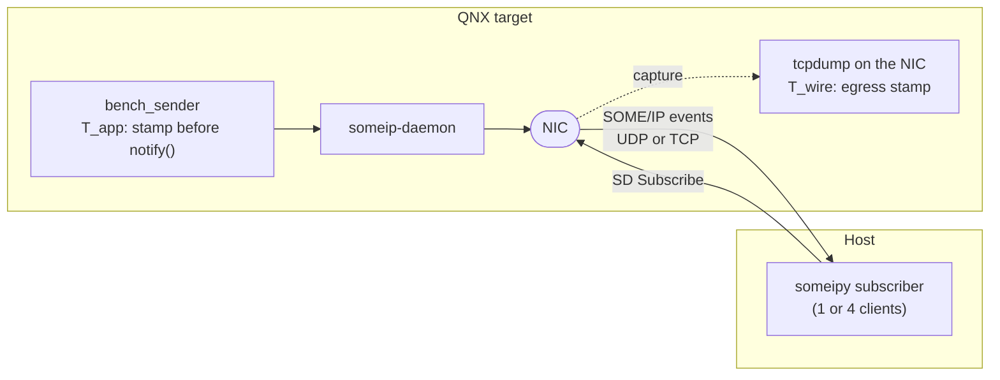
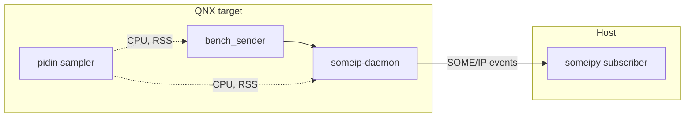
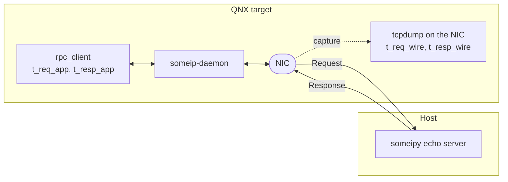

# SOME/IP benchmarks of the lg-someip stack

There are three benchmarks. All of them run the stack on a QNX target (qemu or a board).
The peer runs on the host. The peer is [someipy](https://pypi.org/project/someipy/), an independent Python SOME/IP stack. It does no timing.

The assertions only make sure that the pipeline ran from start to end. No latency has a limit.
Read the tables in the test log. The CSVs, the process logs and the pcap are in `bazel-testlogs/.../test.outputs`.

## Send path

Targets: `benchmark_{udp,tcp}` and `benchmark_{udp,tcp}_4clients`.

This benchmark measures the one-way latency in the sender, `T_wire - T_app`, per event type and size.



- `bench_sender` stamps `T_app` (CLOCK_REALTIME) immediately before `notify()`.
- `tcpdump` on the target stamps `T_wire` on the egress frame. Thus both stamps come from the same clock.
- For a TCP capture, the run turns TSO off on the capture NIC. Thus TCP and UDP-TP both get one stamp per segment.
- The host subscriber only subscribes and receives. Its clock is not used.

## Resources

Targets: `benchmark_{udp,tcp}_resources`.

This benchmark measures the CPU and memory of `someip-daemon` and `bench_sender` per process, under the same load as the send path.



This run has no capture. The sampler makes the target slower, so it never runs while the latency is measured.

## RPC

Target: `benchmark_rpc`.

This benchmark measures the client processing time of an Echo call:
`(t_resp_app - t_req_app) - (t_resp_wire - t_req_wire)`.



The subtraction removes the time on the link and in the echo server. Thus the result is the time in the client and the stack on the target.

## Layout

- `apps/`: `bench_sender` and `rpc_client`, on `lgsomeip::api`.
- `config/`: the lg-someip configs (UDP, TCP, RPC). The run replaces the placeholder unicast address.
- `test_cases/`: the ITF suites, the host-side someipy peers, the qemu and board configs.
- `tools/`: the offline analyzers with their unit tests, and `someip_bench/`, which runs the benchmark on a target.

## Build flags

- `--//score/lg-someip:enable_someip_tp=True`: UDP events larger than one datagram need SOME/IP-TP. Without it, these buckets stay empty.
- `'--per_file_copt=score/lg-someip/.*@-w'`: the QNX-only sources of the stack do not pass the warnings-as-errors of this repository.

## Run on QNX qemu (x86_64)

The qemu connects to a tap device on the host. The guest is 10.0.2.15 and the host is 10.0.2.2.
Make the tap device one time after each boot (it asks for sudo). Remove it with `:teardown_tap`:

```bash
bazel run //score/lg-someip/tests/benchmark/test_cases:setup_tap
```

```bash
bazel test --config=qnx_x86_64 --//score/lg-someip:enable_someip_tp=True \
    '--per_file_copt=score/lg-someip/.*@-w' --test_output=streamed \
    //score/lg-someip/tests/benchmark/test_cases:benchmark_udp_qemu
```

`benchmark_tcp_qemu`, `benchmark_rpc_qemu`, the `*_resources_qemu` and the `*_4clients_qemu` variants run in the same way.

## Run on a board (aarch64)

The run uses the hardware plugin of ITF:

```bash
bazel test --config=qnx_arm64 --//score/lg-someip:enable_someip_tp=True \
    '--per_file_copt=score/lg-someip/.*@-w' --test_output=streamed \
    //score/lg-someip/tests/benchmark/test_cases:benchmark_udp \
    --test_arg=--hardware-config=/abs/path/device.json \
    --test_arg=--capture-iface=<board nic> \
    --test_arg=--host-subscriber-ip=<host ip on the board's subnet> \
    --test_arg=--target-tmp-dir=<writable dir on the board>
```

The run must be the only user of the target. It stops its processes by name and writes to fixed paths below `--target-tmp-dir`.
A board run pins `someip-daemon` to CPU 1, the app to CPU 2 and tcpdump to CPU 3 with QNX `on -C`. Change this with `--test_arg=--someipd-cpu=<n>`, `--app-cpu=<n>` and `--capture-cpu=<n>`. Use `none` to switch the pinning off.
The host must receive the SD group `224.224.224.245` on port 30490 from the target (send path). The target must receive it from the host (RPC).
[PLAYBOOK.md](PLAYBOOK.md) gives the full procedure to compare two revisions on a board.

## Analyzer unit tests

```bash
bazel test //score/lg-someip/tests/benchmark/tools:all
```
