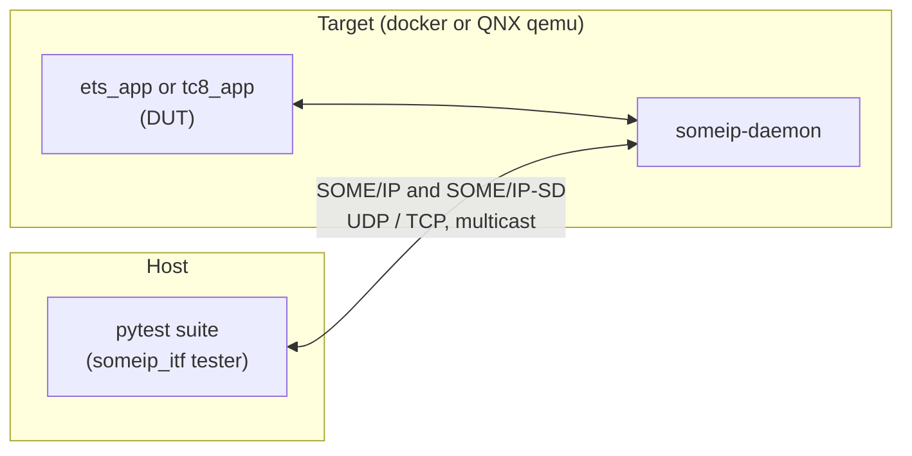

# Functional tests of the lg-someip stack

These tests examine the lg-someip stack on the wire.
A test app on the lg-someip API runs in a target (a Linux docker container, or QNX qemu).
A pytest suite on the host sends SOME/IP and SOME/IP-SD frames to the target and checks the frames that come back.

## Test setup



The ITF plugin starts the target and creates the network between the host and the target.
The DUT gets the test app, the routing daemon and the app config from `config/`.

## Suites

| Family | DUT | What the suites examine |
|---|---|---|
| ETS (`test_ets_*.py`) | `apps/ets/ets_app.cpp`, the Enhanced Testability Service | Methods, events, fields, serialization (arrays, strings, unions, endianness), SOME/IP-TP, error handling, service availability, Service Discovery behavior, client mode, stress |
| TC8 (`test_tc8_*.py`) | `apps/tc8/tc8_app.cpp`, a TC8 test service | SOME/IP message format, Service Discovery format and timing, SD robustness against malformed messages, events, fields, more than one service, SD after a reboot |

`test_cases/suites.bzl` holds the list of suites. Each suite is one Bazel target.
`test_cases/helpers/someip_itf` holds the tester side: frame codecs, the ETS client, SD senders and probes.

## Run

All ETS or all TC8 suites:

```bash
bazel test --test_output=streamed //score/lg-someip/tests/functional/test_cases:ets
bazel test --test_output=streamed //score/lg-someip/tests/functional/test_cases:tc8
```

One suite:

```bash
bazel test --test_output=streamed //score/lg-someip/tests/functional/test_cases:ets_array
```

`ets_stress` is tagged `manual` and runs only when you name it.
The targets are `exclusive` and `requires-network`: the host binds the SD port and joins the SD multicast group.

## Traceability

A test refers to a requirement only through its `@add_test_properties` decorator:

- `partially_verifies` holds OPEN Alliance TC8 IDs (`SOMEIP_ETS_nnn`, `SOMEIPSRV_<GROUP>_nn`) and AUTOSAR IDs (`AS__...`).
- `fully_verifies` holds component requirements (`comp_req__...`).

A test that does not fully check a TC8 case, or checks it in a different way, tells this in its docstring.
