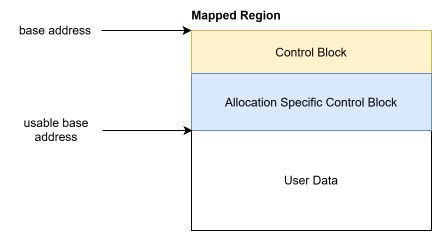
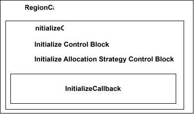

# Shared Memory Redesign

This document describes the redesigned shared memory architecture for `lib-memory-shared`. It complements the class and
the sequence diagrams with rationale and design decisions.

## Architecture Overview

The redesign splits the functionality of `lib-memory-shared` into two layers:

- a lower layer: Creation and management of `mapped memory regions` (POSIX named shared memory, anonymous shared-memory,
  typed memory, etc.) via `MappedRegionFactory` and `MappedRegionRegistry`.
- an upper layer: Providing a PMR-compatible interface via `SharedMemoryResource`, shared-memory capable `OffsetPtr<T>`
  and `PolymorphicOffsetPtrAllocator<T>`.

The upper layer **relies** on the lower layer. The lower layer can be used directly/standalone by clients, who want to
place and manage data in shared memory **without** using PMR. The upper layer is for clients who want to use PMR,
allocators and the infrastructure with ASIL-B qualified (bounds-checking) `OffsetPtrs`.

### Extensibility

The architecture uses interface abstractions heavily for two reasons:

- Testability/Mockability.
- Extensibility in selected areas as shown below.

#### Mapped Regions

A `Mapped Region` is represented by the abstract base class `IMappedRegion` that represents a contiguous memory region
mapped into the process's address space.
`Mapped Region`s are created by `MappedRegionFactory`. Initially, we support _POSIX named shared memory_. Other types of
mapped regions can be added by providing a new class implementing the `IMappedRegion` interface and adding a new
`MappedRegionFactory::CreateXXX()` method, which creates the new type of mapped region.

#### Allocation Strategies

On the upper layer, `SharedMemoryResource` uses an `AllocationStrategy` to implement the actual allocation logic. The
initial implementation uses a monotonic bump allocator. Other allocation strategies can be added by implementing the
`AllocationStrategy` interface. The allocation strategy is passed to `SharedMemoryResourceFactory` CreateXXX methods,
which create a `SharedMemoryResource` with the given allocation strategy.

### Minimal usage of Singletons

To avoid _static destruction order fiasco_, the redesign uses singletons only where necessary. Thus, the only singleton,
we have is the `SharedMemoryResourceRegistrySingleton`. This decision makes the API we provide to the user slightly more
complex, as we require the user to create certain infrastructure objects himself and then hand it over, when creating
other `lib-memory-shared` objects. This is a trade-off we are willing to make, as it makes the code more robust and
testable.

## Mapped Region Layer

As discussed above, the lower layer provides an abstraction for mapped memory regions. The following diagram shows the
structural view of the `Mapped Region Layer`.

### Mapped Regions

A `Mapped Region` is represented by the abstract base class `IMappedRegion`. It represents a contiguous memory region,
being mapped into the process's address space. The interface common to all mapped regions provides methods:

- GetBaseAddress: to get the base address, where it is mapped in process memory.
- GetSize: to get the size of the mapped region.
- GetId: to get the unique id of the region.

Any subclass of `IMappedRegion` must implement these methods. The subclasses of `IMappedRegion` represent different
types of mapped regions. Wherever it makes sense, the subclasses are grouped into abstract base classes to provide a
common interface for similar types of mapped regions. For example, `NamedMappedRegion` is an abstract base class for all
named mapped regions, which provides a common interface for named mapped regions.

When implementing `GetId()` in a subclass, the id must be unique across all mapped regions in the system! This is
important because the id is used to register the `IMappedRegion` into a registry, where it can be looked up by id later
again. To ensure uniqueness, it might make sense to "encode" the type of the region into the id in some cases. E.g.
while for named regions, the id could be simply a hash of the name/path, for other types of regions, the id could be a
combination of the type and a unique number.

Two **important things** regarding the id:

1. The id must not contain properties of the region, which can change over time (e.g., permissions or size). Otherwise,
   the id would change when the properties change, which would break the registry.
2. The id must be **statically** computable, without having to query the region instance itself. This is needed, because
   we do registry checks, whether a region is already registered, before we actually create the region itself. Since the
   acquisition of the id will be done in a code path in the `MappedRegionFactory`, which is **specific** to the type of
   the region, the signature of the static `GetId()` method in implementations of `IMappedRegion` can be also specific
   to the type of the region and not prescribed by the interface.

### MappedRegionFactory and MappedRegionRegistry

An instance of a `Mapped Region`, inheriting from abstract base class `IMappedRegion`, gets created by an instance of
`MappedRegionFactory`. The interface `IMappedRegionFactory`, which `MappedRegionFactory` implements has been introduced
to allow testing/mocking.

`IMappedRegionFactory`/`MappedRegionFactory` has a set of `CreateXXX`/`OpenXXX`/`CreateOrOpenXXX` triples. One such
triple per concrete type of `IMappedRegion` the factory supports. Out of the box we implement/provide
`PosixNamedMappedRegion` as an implementation of `IMappedRegion`. Thus, we also provide `IMappedRegionFactory`/
`MappedRegionFactory` initially with these methods:

- `CreatePosixNamed()`
- `OpenPosixNamed()`
- `CreateOrOpenPosixNamed()`
- `RemovePosixNamed()`

If a new (non-abstract) type of `IMappedRegion` gets introduced, also a corresponding set of create/open/remove methods
need to be added to `IMappedRegionFactory`/`MappedRegionFactory`. The signatures of these create/open/remove methods are
specific to the new (non-abstract) type of `IMappedRegion`, because the information needed to create/open/remove a
concrete type of `IMappedRegion` is specific to this type.

#### Registration of Mapped Regions

A `MappedRegionFactory` can not exist without an instance of an `IMappedRegionRegistry`. The factory uses such an
`IMappedRegionRegistry` instance to store instances of `IMappedRegion`, which it had created. This serves the following
use case:

- within an application/process an instance of an `IMappedRegion` has been created via `MappedRegionFactory`. E.g. via
  `MappedRegionFactory::CreatePosixNamed("someName")`
- If this create-call was successful, the underlying POSIX shared-memory object has been created and mapped into the
  process virtual address space.
- another part in the same application/process calls `MappedRegionFactory::OpenPosixNamed("someName")`. I.e. it wants to
  open the very same `Mapped Region`.
- We do not want, to have a 2nd mapping of the same underlying shared-memory object in the process address-space!
- The factory shall detect that and instead of opening and mem-mapping the same `Mapped Region` twice, it shall return
  the already created/mem-mapped `Mapped Region`.
- Thus, it needs such a registry mechanism.

The `IMappedRegionRegistry` is not really exposed to the user. It is only used internally by the `MappedRegionFactory`.
So, it could have been created internally by `MappedRegionFactory` as an implementation detail. We decided to expose it
as a required construction argument for `MappedRegionFactory` for two reasons:

- allow easier testing of `MappedRegionFactory`. Providing a mock implementation of `IMappedRegionRegistry` helps in
  testing
- we foresee two different implementations of `IMappedRegionRegistry`:
    - `MappedRegionRegistry`: This implementation internally only stores `weak_ptr`s to registered `IMappedRegion`s.
      Thus, when the last `shared_ptr<IMappedRegion>` handed out by the `MappedRegionFactory` for a given
      `IMappedRegion` has been destroyed, it will also be gone from the `MappedRegionRegistry`. This means a
      new/explicit call to `MappedRegionFactory::Create()` is needed to re-create/re-map this concrete `IMappedRegion`
      instance.
    - `PersistentMappedRegionRegistry`: This implementation internally stores `shared_ptr`s and therefore **extends**
      the life-time of registered `IMappedRegion`s. Even if all users have discarded their `shared_ptr`s to the given
      `IMappedRegion`. If later a user calls `MappedRegionFactory::Create()` again, which would result in creating the
      same instance of `IMappedRegion` re-creation/re-mapping is skipped and the stored `IMappedRegion` instance is
      returned.

The `PersistentMappedRegionRegistry` has the following pros and cons:

- pro: In case the creation/mapping of a `Mapped Region` is "expensive", the life-time extension done by the
  `PersistentMappedRegionRegistry` might be helpful. I.e. if the same `IMappedRegion` is used later in the application
  life-cycle again, it might save time.
- con: Keeping an `IMappedRegion` blocks/requires physical memory, which backs the `Mapped Region`! So keeping it in
  times, where no one is using it, can be detrimental.

So, there is a tradeoff in usage between `MappedRegionRegistry` and `PersistentMappedRegionRegistry`. And there is in
both cases the possibility to control, how long a `IMappedRegion` instance is kept via these additional APIs:

- `Unregister(IdType)`: Explicitly remove a specific `IMappedRegion` instance from the registry. Has the same effect for
  both implementations.
- `Clear()`: Explicitly remove all `IMappedRegion` instances from the registry. Has the same effect for both
  implementations.
- `FreeUnusedResources()`: This is a no-op in case of `MappedRegionRegistry`! In case of
  `PersistentMappedRegionRegistry`, it removes all `IMappedRegion` instances, which are only held by itself.

#### Semantics of Create, Open, Remove

The properties of different types of `IMappedRegion` will be so different, that we need to come up with a general
definition, what Create, Open and Remove shall mean:

##### Create

Create means, that a concrete instance of `IMappedRegion` has been created and its underlying memory has been
contiguously mapped into the virtual address space of the caller. Additionally, it means, that this `Mapped Region` then
is "visible", so it can be successfully opened by the corresponding call to `MappedRegionFactory::OpenXXX` in the same
or a different process. A 2nd Create call with the same identification (in POSIX named shared-memory this would be the
path) will fail in the same or a different process. Unless, Remove had been called before with the same identification
in the same or a different process.

##### Open

Open shall always open the latest version of a given `Mapped Region`. I.e. if a sequence of Create/Remove operations
have happened for a `Mapped Region` with the same identification, Open will return a `IMappedRegion` instance, which
always represents the latest created `Mapped Region` with this identification. If the last operation for this
identification was a Remove or no Create operation has happened before in the same or a different process, Open shall
return a nullptr.

##### Remove

Remove shall remove the `Mapped Region` in a way, that any subsequent call to Open with the same identification will
fail in the same or a different process, unless a new Create operation has been done with the same identification in the
same or a different process.

To fulfill these semantics for any `IMappedRegion` both &ndash; `MappedRegionFactory` and `MappedRegionRegistry` &ndash;
have to act accordingly.

### Creating a Mapped Region

The following sequence shows the needed steps and involved actors, when the user creates an `IMappedRegion` instance. In
this case an `IMappedRegion` instance of type `PosixNamedMappedRegion`.

**Explanation:**

1. The user creates a `MappedRegionRegistry` to be used/owned by the `MappedRegionFactory`. The user in this case
   decided for the non-persistent registry. He could have also created a `PersistentMappedRegionRegistry` instead.
2. The user creates a `MappedRegionFactory` and hands over the registry instance to it.
3. The user calls `MappedRegionFactory::CreatePosixNamed()` with the arguments necessary to create a
   `PosixNamedMappedRegion` instance. Additionally, the user provides a `RegionInitializeCallback`, which is called by
   the factory after the region has been created and mapped into the process address space. This callback allows the
   user to initialize the memory in the region. Note, that this callback is only called, when the region has been
   created for the first time. If the region already exists, the callback is not called. The `RegionInitializeCallback`
   argument is part of all `CreateXXX`/`CreateOrOpenXXX` methods of `MappedRegionFactory`.
4. For the later/upcoming call to `MappedRegionRegistry::Register(IdType, CreateRegionCallback, ...)` 1st the id for the
   to be created `PosixNamedMappedRegion` has to be constructed. This is because the registry needs the id to check,
   whether a region with this id already exists in the registry and the region gets created by the registry via the
   `CreateRegionCallback` only if it does not exist yet. The id is constructed by the factory based on the arguments
   provided by the user via a region type specific static method. Here in case of `PosixNamedMappedRegion` via
   `PosixNamedMappedRegion::CreateId(path)`.
5. Next `MappedRegionFactory` creates a `CreateRegionCallback` (a lambda) for the creation of the
   `PosixNamedMappedRegion` instance based on the user provided arguments. This callback will later be called by the
   registry, if the region does not exist yet. When the `MappedRegionFactory` creates the specific
   `CreateRegionCallback` (in this case for the creation of a `PosixNamedMappedRegion`), it appends the call to the user
   provided `RegionInitializeCallback` as the last step/instruction to the created `CreateRegionCallback`. This kind of
   stacking/wrapping is necessary as we want the user provided initialization of the region to happen atomically within
   the creation (see [Registering a Mapped Region](#registering-a-mapped-region)).
6. Next `MappedRegionFactory` creates an `AdjustRegionCallback` (a lambda) for the adjustment of the
   `PosixNamedMappedRegion` instance based on the user provided arguments. This callback will later be called by the
   registry, if a region for the given id already exists and needs to be adjusted to the user provided arguments. E.g.
   if the user provided a size, which is larger than the existing region size. Note, that an `AdjustRegionCallback` is
   optional. If a specific type of `IMappedRegion` does not support adjustment, the factory will provide a
   `std::nullopt`
   in this case,
7. `MappedRegionFactory` calls `MappedRegionRegistry::Register(IdType, CreateRegionCallback, AdjustRegionCallback)`. We
   assume the good case here, where the `MappedRegionRegistry::Register()` was successful and returned a `Result` with a
   valid `shared_ptr<IMappedRegion>` to the factory.
8. This `Result` with a valid `shared_ptr<IMappedRegion>` is returned to the user.

#### Registering a Mapped Region

The reason, why the `MappedRegionFactory` does not create the `IMappedRegion` instance **directly**, but hands over a
`CreateRegionCallback` to the `MappedRegionRegistry` to let the registry execute the creation, is the following:
The registration and the creation/adjustment of the `IMappedRegion` instance must be **atomic**. Thus, the registry will
acquire a registry instance specific lock in the entrance of a `Register()` call. Then it checks, whether a region with
the given id already exists in the registry. If not, it calls the `CreateRegionCallback` and does the insertion into its
map all under lock.

Depending on the implementation of `IMappedRegionRegistry`, the sequence within the `Register()` call looks different.
I.e. the referenced sequences (via `ref Register Region`) can be either the sequence for the "regular"
`MappedRegionRegistry::Register()`:

or the sequence for the `PersistentMappedRegionRegistry::Register()`:

**Explanation:**

1. Initially both `Register()` implementations are equal: They take a registry instance wide lock and check, whether the
   region with the `IdType` already exists.
2. In the case, that no region identified by `IdType` exists, both implementations behave identically: They call the
   provided `CreateRegionCallback` and (if successful) insert the region into their map. Here the
   `PersistentMappedRegionRegistry` will store a `shared_ptr<IMappedRegion>`, while `MappedRegionRegistry` will store a
   `weak_ptr<IMappedRegion>`. Then they release the lock before returning a `shared_ptr` to the created `IMappedRegion`
   instance to the caller.
3. In case there already exists a region identified by `IdType`, both implementation diverge.
    1. In case of non-persistent `MappedRegionRegistry` lock gets released and an Error is returned.
    2. In case of `PersistentMappedRegionRegistry` lock gets released and an Error is returned only if a user is
       currently using this `IMappedRegion` instance.
    3. In case of `PersistentMappedRegionRegistry` if no user is currently using this `IMappedRegion` instance,
        - either the instance gets adjusted by calling `AdjustRegionCallback(IMappedRegion&)`
        - or &ndash; if there is no `AdjustRegionCallback` &ndash; then this `IMappedRegion` instance gets destroyed and
          a new instance gets created by calling the provided `CreateRegionCallback` and (if successful) inserted into
          the map.
        - then the lock is released before returning a `shared_ptr` to the adjusted/created `IMappedRegion` instance to
          the caller.

## The Polymorphic Memory Resource (PMR) Layer

As discussed [above](#architecture-overview), the upper layer provides a C++ PMR interface on top of the lower
`Mapped Region Layer` discussed in the previous section, and it **depends** on the lower layer.

So, this is what the `PMR layer` provides additionally:

- a `SharedMemoryResource` class, which has the interface of
  a [C++ memory_resource](https://en.cppreference.com/cpp/memory/memory_resource) and provides pluggable memory
  allocation strategies.
- a specific shared-memory capable allocator in the form of `PolymorphicOffsetPtrAllocator<T>`, which allocates from a
  `SharedMemoryResource` and returns special pointers, which can be used within shared-memory.
- `OffsetPtr<T>` as the shared-memory capable pointer type created by `PolymorphicOffsetPtrAllocator<T>`, which supports
  ASIL-B environments via bounds-checking of `OffsetPtr<T>` access.

Thus, the lower `Mapped Region Layer` can be used **stand-alone** by applications, which only want to access specific
memory mapped memory regions, **without** taking benefit of the functionality and abstractions the PMR layer provides.
However, we expect, that most users/applications will use the `PMR layer`!

This is the structural view of the `PMR layer`, which will be discussed in detail in this section:

### Shared Memory Resource

The central class in this layer is the `SharedMemoryResource`. Opposed to the previous design, which gets now replaced,
there is no inheritance hierarchy anymore with a `ManagedMemoryResource` and a derived `SharedMemoryResource`!
`SharedMemoryResource` contains the functionality of the old `ManagedMemoryResource` and on the other hand got massively
simplified as most of its previous functionality has now been moved into the `Mapped Region Layer` &ndash; namely into
implementations of `IMappedRegion`.

This gets obvious from the ctor signature:
`SharedMemoryResource(shared_ptr<IMappedRegion>, unique_ptr<IAllocationStrategy>)`

I.e. a `SharedMemoryResource` is constructed from a `Mapped Region` and a memory allocation strategy.

Since `SharedMemoryResource` needs to fulfill C++ PMR semantics, it implements `score::cpp::pmr::memory_resource`. For
testing/mocking purpose we introduce `ISharedMemoryResource`, which inherits from `score::cpp::pmr::memory_resource`
and adds the following public interface:

- `GetBaseAddress()`: This returns a pointer to the (mapped) start address of the underlying `IMappedRegion` instance.
- `GetUsableBaseAddress()`: This returns a pointer to the (mapped) start address of the memory being usable by the user
  of the `SharedMemoryResource`. This differs from the BaseAddress as a `SharedMemoryResource` needs some management
  space, which is not available for "user data". This interface is seldomly used by users!
- `GetMemoryResourceProxy()`: Returns a `Proxy` for the `SharedMemoryResource`, which can be stored in shared-memory.
  (see [MemoryResourceProxy](#memoryresourceproxy-requires-sharedmemoryresourceregistry-as-a-singleton))
- `GetMappedRegion()` : Returns a reference to the underlying `IMappedRegion`, it was constructed from.

The memory-pool on which a `SharedMemoryResource` does its allocation/deallocation is provided by the `IMappedRegion`
instance, it was constructed from.

#### Control Block

Like in the old design a `SharedMemoryResource` instance has a basic `ControlBlock` at the beginning of the memory
region, which contains two fields:

- `MemoryResourceProxy`, which is basically a unique id of the `SharedMemoryResource` instance.
- `AllocationStrategyType`, which is an enum to identify the allocation strategy used by the `SharedMemoryResource`
  instance.

Adjacent to the `ControlBlock` is the memory used by the `AllocationStrategy` instance, which is used by the
`SharedMemoryResource` instance to manage the memory pool provided by the underlying `IMappedRegion`. The layout and
content of the `Allocation Specific Control Block` depends on the allocation strategy used by the `SharedMemoryResource`
instance. The `IAllocationStrategy` implementation used in the construction of the `SharedMemoryResource` instance gets
called with `ConstructAllocationSpecificControlBlock()` to construct the `Allocation Specific Control Block` in the
memory region. The final layout set up in the `IMappedRegion` instance then looks like this:

#### Allocation Strategy

##### Monotonic Bump Allocator

We initaially provide only one implementation for `IAllocationStrategy` &ndash; a monotonic bump allocator. This is the
simplest allocation strategy and at the same time the most robust one and ASIL-B qualified strategy. It is implemented
by class `MonotonicAllocationStrategy`.

Its specific `Allocation Specific Control Block` contains only one field: `already_allocated_bytes`, which is an atomic
<size_t> and keeps track of the already allocated bytes in the memory pool. Synchronization between multiple threads is
simple: An atomic store either happened or it didn't; there's no half-written state. If the previous holder died before
the store, the old value is valid. If it died after, the new value is valid (a few bytes are wasted for an allocation
nobody will use, but the allocator state is consistent).

##### Future Allocation Strategies

Future more complex allocation strategies (e.g., a dynamic allocator with free lists) would most likely need
synchronizations based on interprocess mutexes as lock-free synchronization is hard to realize for complex data
structures. In this case, the `Allocation Specific Control Block` would need to contain a
`score::concurrency::InterProcessMutex`.

###### The Problem

The `InterProcessMutex` currently is `PTHREAD_PROCESS_SHARED` but not `PTHREAD_MUTEX_ROBUST`. If a QM process crashes
while holding the mutex, the next caller gets an error from `pthread_mutex_lock()`, and our
`InterprocessMutex::lock()` calls `std::terminate()`. If that next caller is ASIL-B, we just crashed a safety-critical
process because some QM process died. That's a freedom-from-interference violation reducing availability.

###### The Fix

We set `PTHREAD_MUTEX_ROBUST` on the mutex. The kernel tracks who holds it. If that process dies, the next
`pthread_mutex_lock()` returns `EOWNERDEAD` instead of deadlocking or failing.

`InterprocessMutex::lock()` returns `LockResult { Acquired, AcquiredAfterOwnerDied }`. On `EOWNERDEAD`, it calls
`pthread_mutex_consistent()` internally and returns `AcquiredAfterOwnerDied` so the caller knows what happened.

We set `PTHREAD_MUTEX_ROBUST` on the mutex. The kernel tracks who holds it. If that process dies, the next
`pthread_mutex_lock()` returns `EOWNERDEAD` instead of deadlocking or failing.

`InterprocessMutex::lock()` returns `LockResult { Acquired, AcquiredAfterOwnerDied }`. On `EOWNERDEAD`, it calls
`pthread_mutex_consistent()` internally and returns `AcquiredAfterOwnerDied` so the caller knows what happened.

A dynamic allocator with free lists would need additional machinery because mid-mutation crashes can corrupt multi-step
pointer updates. Specifically:

- An `operation_in_progress` dirty flag in the ControlBlock, set before mutation, cleared after. If the process dies
  mid-mutation, the flag stays true.
- An `OnOwnerDied()` recovery hook on AllocationStrategy. The dynamic strategy checks the dirty flag and returns
  `Corrupted` if set (free lists may be half-updated). If recovery fails, the flag is left set as a permanent corruption
  marker — the next normal lock sees it and returns an error.
- Both `do_allocate()` and `do_deallocate()` would need this protocol, since freeing memory also modifies the list.

Recovery logic is the strategy implementer's responsibility. The framework provides `lock_robust()` and the `EOWNERDEAD`
signal. The strategy knows its own data structures and how to check whether they're consistent or not.

### Shared Memory Resource Factory and Registry

Instances of `SharedMemoryResource` are created by `SharedMemoryResourceFactory`. An instance of the factory is
constructed with a `unique_ptr<IMappedRegionFactory>`. I.e. the factory being constructed owns an instance of an
`IMappedRegionFactory` and uses it to create `IMappedRegion` instances. This is the connection between the `PMR Layer`
and the `Mapped Region Layer`:

Again for testing/mocking purposes we introduce `ISharedMemoryResourceFactory`, which is the interface of
`SharedMemoryResourceFactory`. It structurally provides the same set of `CreateXXX`/`OpenXXX`/`CreateOrOpenXXX` triples
as `IMappedRegionFactory`/`MappedRegionFactory`. This is expected, as the `SharedMemoryResourceFactory` dispatches the
creation/opening of `IMappedRegion` instances, which the created `SharedMemoryResource` will wrap, to the underlying
`IMappedRegionFactory`/`MappedRegionFactory`. The signatures of these methods on the level of
`ISharedMemoryResourceFactory`/`SharedMemoryResourceFactory` add arguments for an `InitializeCallback` and a
`unique_ptr<IAllocationStrategy>`.

Similar to the `MappedRegionFactory`, the `SharedMemoryResourceFactory` uses a registry to store and look up instances
of `SharedMemoryResource`. Opposed to `MappedRegionFactory`s registry, the `SharedMemoryResourceRegistry` instance being
used by `SharedMemoryResourceFactory` is not handed over on construction. Instead, this registry is a **singleton**,
which gets looked up by `SharedMemoryResourceFactory` on demand.

As shown in the sequence diagram above, `SharedMemoryResourceFactory` registers a `SharedMemoryResource` at the
`SharedMemoryResourceRegistry` after construction. It will be registered under the `ID` being returned by
`SharedMemoryResource::GetId()`.

#### Stacking of InitializeCallbacks

When we described [how a MappedRegion gets registered in the MappedRegionRegistry](#registering-a-mapped-region), we
layed out, that the `MappedRegionFactory` doesn't itself create the `Mapped Region`, but created a
`CreateRegionCallback` instead for the creation of the `IMappedRegion` instance and passed it down to the
`MappedRegionRegistry::Register()`, to get it "atomically" created and registered.

When we are at the `PMR Layer` there is more than just the creation of the `Mapped Region`, which shall be done
"atomically". Also, initializations of the `Mapped Region` have to be done in the same "atomic" step:

- The `SharedMemoryResource` needs its `ControlBlock` to be initialized.
- The `AllocationStrategy` needs its `Allocation Specific Control Block` to be initialized.
- The user might want to initialize the memory in the `Mapped Region` for his own purposes. Beause of this the user
  hands over an `InitializeCallback` to the `SharedMemoryResourceFactory::CreateXXX()`/`CreateOrOpenXXX()` methods.

Effectively we will have a stack of `InitializeCallbacks` being called in the order of:

From top-down call chain perspective this means:

1. The user calls SharedMemoryResourceFactory::CreateXXX () with his `InitializeCallback`.
2. The `SharedMemoryResourceFactory` creates a `InitializeRegionCallback`. There it adds the initialization of the
   `ControlBlock` and the initialization of the `Allocation Specific Control Block` and adds the call to the user
   provided `InitializeCallback` and passes this stacked callback down to the `MappedRegionFactory`.
3. The `MappedRegionFactory` creates a `CreateRegionCallback` for the creation of the `IMappedRegion` instance and adds
   the call to the stacked `InitializeRegionCallback` and passes this stacked callback down to the
   `MappedRegionRegistry`.

#### `MemoryResourceProxy` requires `SharedMemoryResourceRegistry` as a Singleton

The reason for `SharedMemoryResourceRegistry` being a singleton (like in the old design) is, that we need a lookup
mechanism for `SharedMemoryResource` instances from shared-memory.

**Recall:** We can't store instances of `SharedMemoryResource` within shared-memory. `SharedMemoryResource` is
polymorphic (derives from `ISharedMemoryResource`) and stores references. These facts already exclude the possibility to
store instances of `SharedMemoryResource` in shared-memory. Instead, we keep the approach from the old design, where we
have a `MemoryResourceProxy`, where instances of it can be easily stored in shared-memory as they only consist of a key
(this is the same as `SharedMemoryResource::GetId()` returns). This key is then used to look up the
`SharedMemoryResource` instance related to the `MemoryResourceProxy` stored in shared-memory from the process local
`SharedMemoryResourceRegistry`. To achieve this, we need a `SharedMemoryResourceRegistry` singleton!

Thus, we keep `PolymorphicOffsetPtrAllocator` storing a `MemoryResourceProxy` as its memory resource instance, as
`PolymorphicOffsetPtrAllocator` instances need to be stored in shared-memory.

As described above: `SharedMemoryResourceFactory` also gets access to the `SharedMemoryResourceRegistry` instance it
uses via the singleton lookup. I.e. it does not get the `SharedMemoryResourceRegistry` instance via injection/ctor
argument. To still allow unit-testing/mocking for `SharedMemoryResourceFactory`, we allow to inject a mock registry into
the `SharedMemoryResourceRegistry` singleton via `InjectMock(ISharedMemoryResourceRegistry*)` method.

