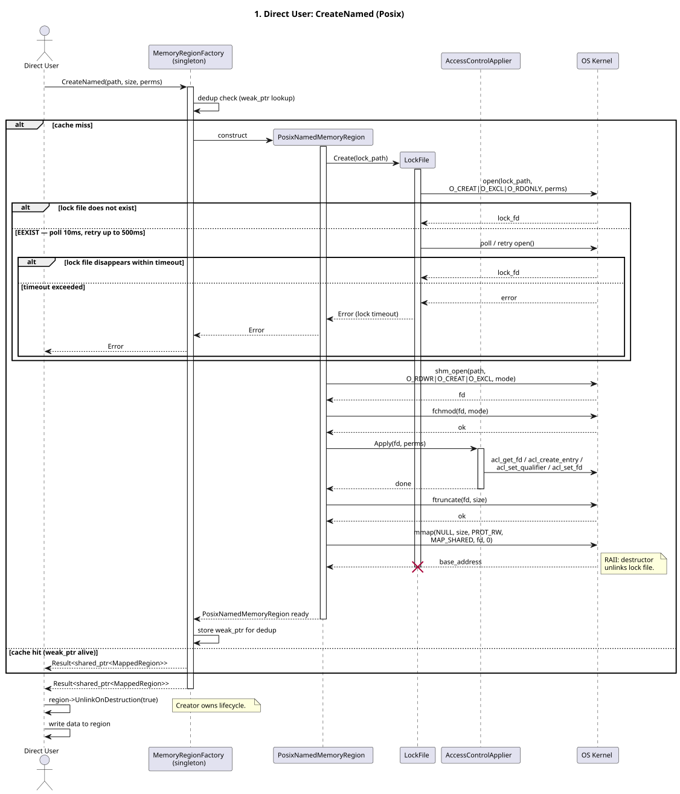
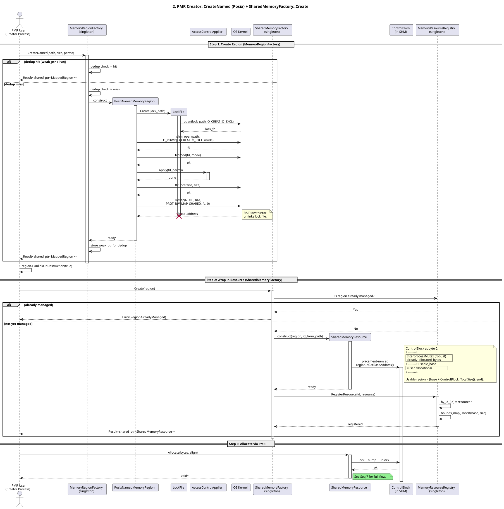
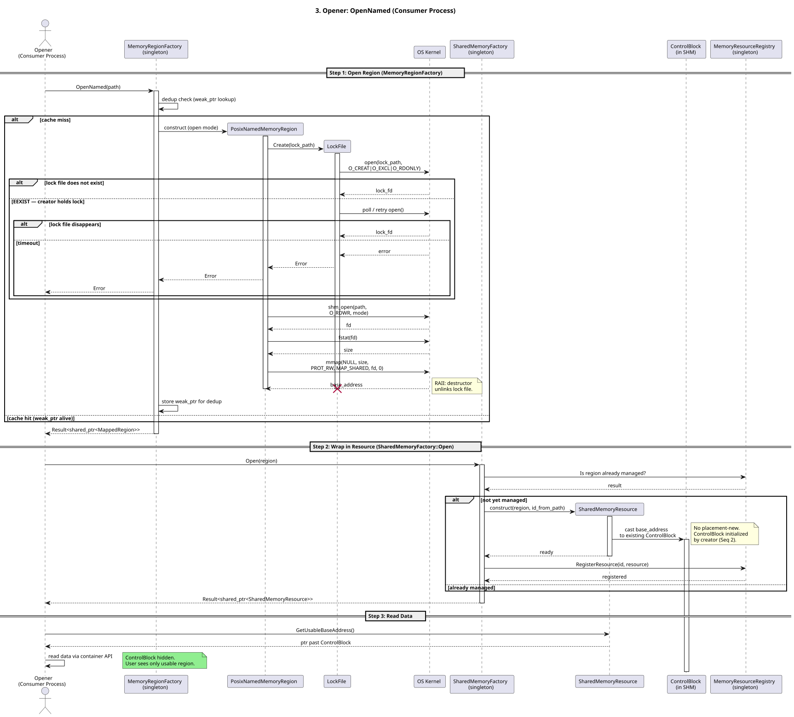
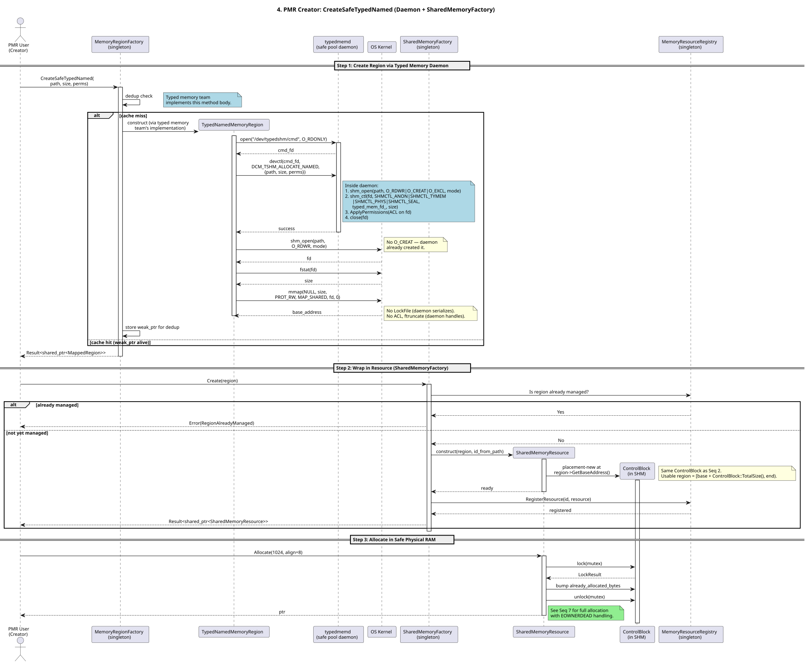
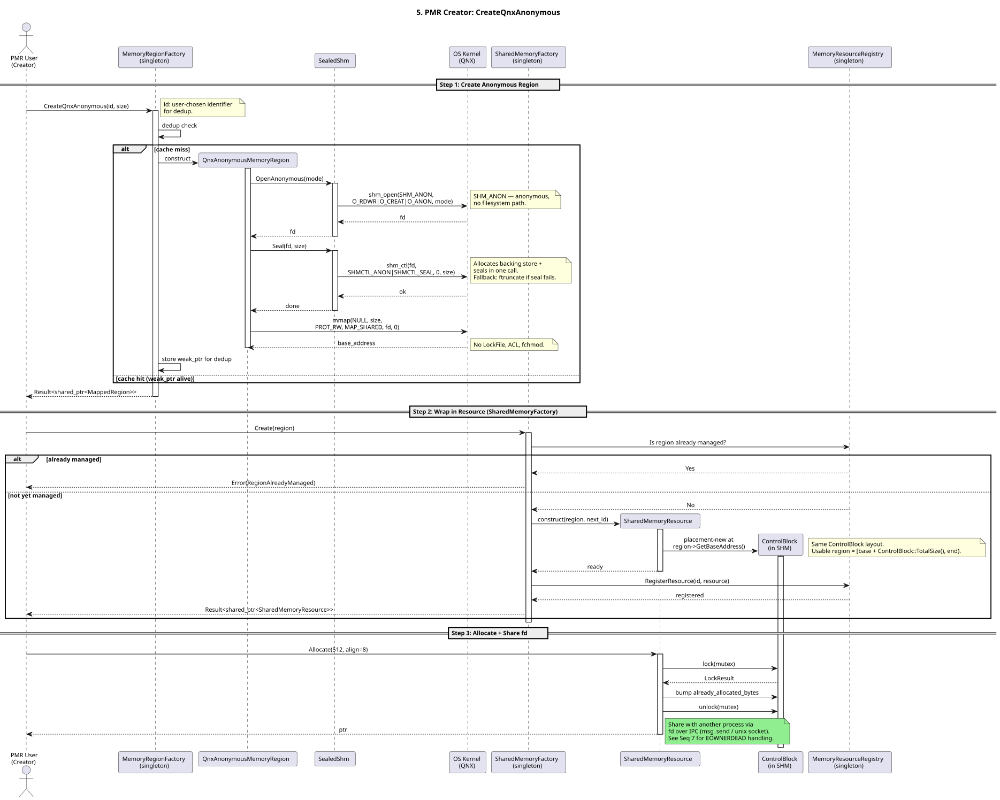
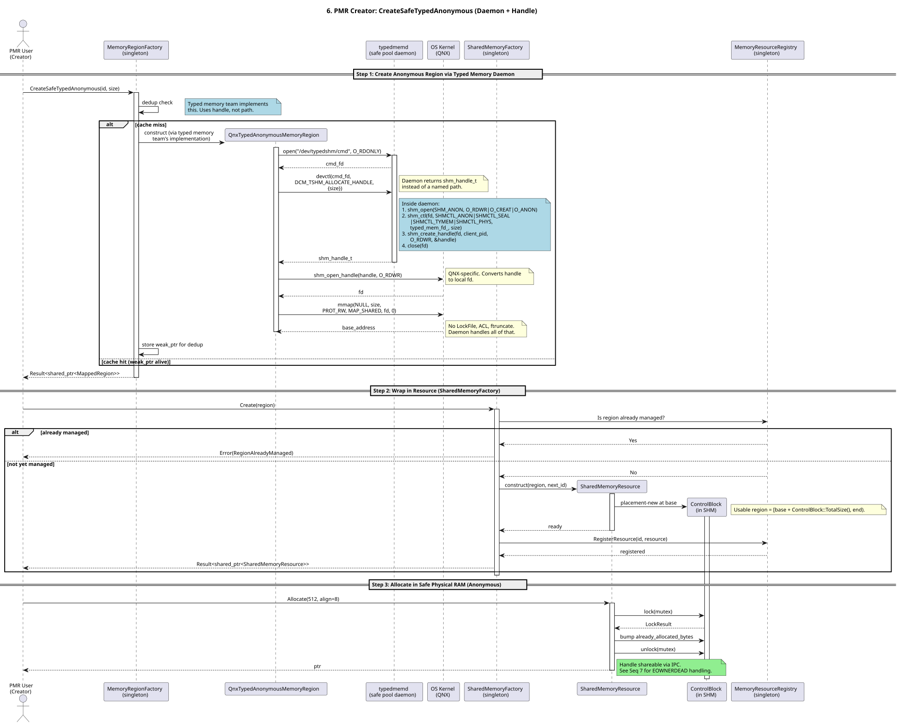
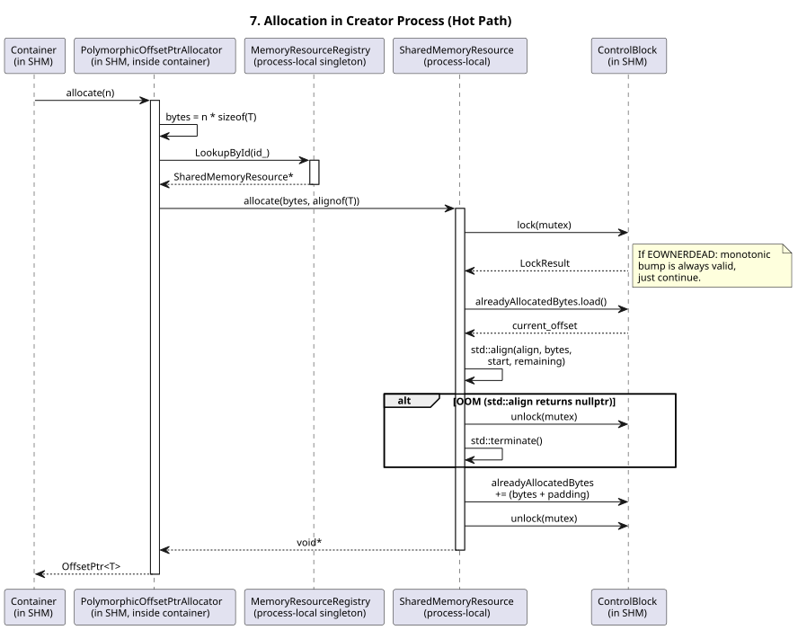
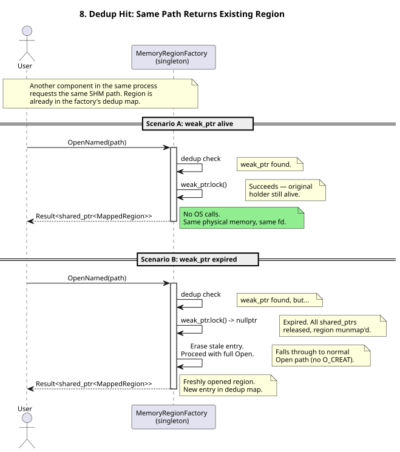
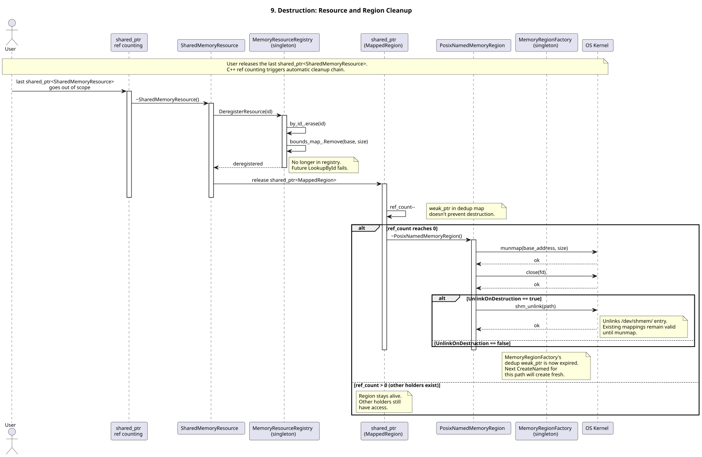

# Shared Memory Redesign

This document describes the redesigned shared memory architecture for `lib-memory-shared`. It complements the class and
the sequence diagrams with rationale and design decisions.

## Architecture Overview

The redesign splits the functionality of `lib-memory-shared` into two layers:

- a lower layer: Creation and management of `mapped memory regions` (POSIX named shared memory, anonymous shared-memory,
  typed memory, etc.) via `MappedRegionFactory` and `MappedRegionRegistry`.
- an upper layer: Providing a PMR-compatible interface via `SharedMemoryResource`, shared-memory capable `OffsetPtr<T>`
  and `PolymorphicOffsetPtrAllocator<T>`.

The upper layer **relies** on the lower layer. The lower layer can be used directly/standalone by clients, who want to
place and manage data in shared memory **without** using PMR. The upper layer is for clients who want to use PMR,
allocators and the infrastructure with ASIL-B qualified (bounds-checking) `OffsetPtrs`.

### Extensibility

The architecture uses interface abstractions heavily for two reasons:

- Testability/Mockability.
- Extensibility in selected areas as shown below.

#### Mapped Regions

A `Mapped Region` is represented by the abstract base class `IMappedRegion` that represents a contiguous memory region
mapped into the process's address space.
`Mapped Region`s are created by `MappedRegionFactory`. Initially, we support _POSIX named shared memory_. Other types of
mapped regions can be added by providing a new class implementing the `IMappedRegion` interface and adding a new
`MappedRegionFactory::CreateXXX()` method, which creates the new type of mapped region.

#### Allocation Strategies

On the upper layer, `SharedMemoryResource` uses an `AllocationStrategy` to implement the actual allocation logic. The
initial implementation uses a monotonic bump allocator. Other allocation strategies can be added by implementing the
`AllocationStrategy` interface. The allocation strategy is passed to `SharedMemoryResourceFactory` CreateXXX methods,
which create a `SharedMemoryResource` with the given allocation strategy.

### Minimal usage of Singletons

To avoid _static destruction order fiasco_, the redesign uses singletons only where necessary. Thus, the only singleton,
we have is the `SharedMemoryResourceRegistrySingleton`. This decision makes the API we provide to the user slightly more
complex, as we require the user to create certain infrastructure objects himself and then hand it over, when creating
other `lib-memory-shared` objects. This is a trade-off we are willing to make, as it makes the code more robust and
testable.

## Mapped Region Layer

As discussed above, the lower layer provides an abstraction for mapped memory regions. The following diagram shows the
structural view of the Mapped Region Layer.


### Mapped Regions

A `Mapped Region` is represented by the abstract base class `IMappedRegion`. It represents a contiguous memory region,
being mapped into the process's address space. The interface common to all mapped regions provides methods:

- GetBaseAddress: to get the base address, where it is mapped in process memory.
- GetSize: to get the size of the mapped region.
- GetId: to get the unique id of the region.

Any subclass of `IMappedRegion` must implement these methods. The subclasses of `IMappedRegion` represent different
types of mapped regions. Wherever it makes sense, the subclasses are grouped into abstract base classes to provide a
common interface for similar types of mapped regions. For example, `NamedMappedRegion` is an abstract base class for all
named mapped regions, which provides a common interface for named mapped regions.

When implementing `GetId()` in a subclass, the id must be unique across all mapped regions in the system! This is
important because the id is used to register the `IMappedRegion` into a registry, where it can be looked up by id later
again. To ensure uniqueness, it might make sense to "encode" the type of the region into the id in some cases. E.g.
while for named regions, the id could be simply a hash of the name/path, for other types of regions, the id could be a
combination of the type and a unique number.

Two **important things** regarding the id:

1. The id must not contain properties of the region, which can change over time (e.g., permissions or size). Otherwise,
   the id would change when the properties change, which would break the registry.
2. The id must be **statically** computable, without having to query the region instance itself. This is needed, because
   we do registry checks, whether a region is already registered, before we actually create the region itself. Since the
   acquisition of the id will be done in a code path in the `MappedRegionFactory`, which is **specific** to the type of
   the region, the signature of the static `GetId()` method in implementations of `IMappedRegion` can be also specific
   to the type of the region and not prescribed by the interface.

### MappedRegionFactory and MappedRegionRegistry

An instance of a `Mapped Region`, inheriting from abstract base class `IMappedRegion`, gets created by an instance of
`MappedRegionFactory`. The interface `IMappedRegionFactory`, which `MappedRegionFactory` implements has been introduced
to allow testing/mocking.

`IMappedRegionFactory`/`MappedRegionFactory` has a set of `CreateXXX`/`OpenXXX`/`CreateOrOpenXXX` triples. One such
triple per concrete type of `IMappedRegion` the factory supports. Out of the box we implement/provide
`PosixNamedMappedRegion` as an implementation of `IMappedRegion`. Thus, we also provide `IMappedRegionFactory`/
`MappedRegionFactory` initially with these methods:

- `CreatePosixNamed()`
- `OpenPosixNamed()`
- `CreateOrOpenPosixNamed()`

If a new (non-abstract) type of `IMappedRegion` gets introduced, also a corresponding triple of create/open methods need
to be added to `IMappedRegionFactory`/`MappedRegionFactory`. The signatures of these create/open methods are specific to
the new (non-abstract) type of `IMappedRegion`, because the information to create/open a concrete type of
`IMappedRegion`
is specific to this type.

A `MappedRegionFactory` can not exist without an instance of an `IMappedRegionRegistry`. The factory uses such an
`IMappedRegionRegistry` instance to store instances of `IMappedRegion`, which it had created. This serves the following
use case:

- within an application/process an instance of an `IMappedRegion` has been created via `MappedRegionFactory`. E.g. via
  `MappedRegionFactory::CreatePosixNamed("someName")`
- If this create-call was successful, the underlying POSIX shared-memory object has been created and mapped into the
  process virtual address space.
- another part in the same application/process calls `MappedRegionFactory::OpenPosixNamed("someName")`. I.e. it wants to
  open the very same `Mapped Region`.
- We do not want, to have a 2nd mapping of the same underlying shared-memory object in the process address-space!
- The factory shall detect that and instead of opening and mem-mapping the same `Mapped Region` twice, it shall return
  the already created/mem-mapped `Mapped Region`.
- Thus, it needs such a registry mechanism.

The `IMappedRegionRegistry` is not really exposed to the user. It is only used internally by the `MappedRegionFactory`.
So, it could have been created internally by `MappedRegionFactory` as an implementation detail. We decided to expose it
as a required construction argument for `MappedRegionFactory` for two reasons:

- allow easier testing of `MappedRegionFactory`. Providing a mock implementation of `IMappedRegionRegistry` helps in
  testing
- we foresee two different implementations of `IMappedRegionRegistry`:
    - `MappedRegionRegistry`: This implementation internally only stores `weak_ptr`s to registered `IMappedRegion`s.
      Thus, when the last `shared_ptr<IMappedRegion>` handed out by the `MappedRegionFactory` for a given
      `IMappedRegion` has been destroyed, it will also be gone from the `MappedRegionRegistry`. This means a
      new/explicit call to `MappedRegionFactory::Create()` is needed to re-create/re-map this concrete `IMappedRegion`
      instance.
    - `PersistentMappedRegionRegistry`: This implementation internally stores `shared_ptr`s and therefore **extends**
      the life-time of registered `IMappedRegion`s. Even if all users have discarded their `shared_ptr`s to the given
      `IMappedRegion`. If later a user calls `MappedRegionFactory::Create()` again, which would result in creating the
      same instance of `IMappedRegion` re-creation/re-mapping is skipped and the stored `IMappedRegion` instance is
      returned.

The `PersistentMappedRegionRegistry` has the following pros and cons:

- pro: In case the creation/mapping of a `Mapped Region` is "expensive", the life-time extension done by the
  `PersistentMappedRegionRegistry` might be helpful. I.e. if the same `IMappedRegion` is used later in the application
  life-cycle again, it might save time.
- con: Keeping an `IMappedRegion` blocks/requires physical memory, which backs the `Mapped Region`! So keeping it in
  times, where no one is using it, can be detrimental.

So, there is a tradeoff in usage between `MappedRegionRegistry` and `PersistentMappedRegionRegistry`. And there is in
both cases the possibility to control, how long a `IMappedRegion` instance is kept via these additional APIs:

- Unregister (IdType): Explicitly remove a specific `IMappedRegion` instance from the registry. Has the same effect for
  both implementations.
- Clear (): Explicitly remove all `IMappedRegion` instances from the registry. Has the same effect for both
  implementations.
- FreeUnusedResources (): This is a no-op in case of `MappedRegionRegistry`! In case of
  `PersistentMappedRegionRegistry`, it removes all `IMappedRegion` instances, which are only held by itself.

### Creating a Mapped Region

The following sequence shows the needed steps and involved actors, when the user creates an `IMappedRegion` instance. In
this case an `IMappedRegion` instance of type `PosixNamedMappedRegion`.


Explanation:

1. The user creates a `MappedRegionRegistry` to be used/owned by the `MappedRegionFactory`. The user in this case
   decided for the non-persistent registry. He could have also created a `PersistentMappedRegionRegistry` instead.
2. The user creates a `MappedRegionFactory` and hands over the registry instance to it.
3. The user calls `MappedRegionFactory::CreatePosixNamed()` with the arguments necessary to create a
   `PosixNamedMappedRegion` instance. Additionally, the user provides a `RegionInitializeCallback`, which is called by
   the factory after the region has been created and mapped into the process address space. This callback allows the
   user to initialize the memory in the region. Note, that this callback is only called, when the region has been
   created for the first time. If the region already exists, the callback is not called. The `RegionInitializeCallback`
   argument is part of all `CreateXXX`/`CreateOrOpenXXX` methods of `MappedRegionFactory`.
4. For the later/upcoming call to `MappedRegionRegistry::Register(IdType, CreateRegionCallback, ...)` 1st the id for the
   to be created `PosixNamedMappedRegion` has to be constructed. This is because the registry needs the id to check,
   whether a region with this id already exists in the registry and the region gets created by the registry via the
   `CreateRegionCallback` only if it does not exist yet. The id is constructed by the factory based on the arguments
   provided by the user via a region type specific static method. Here in case of `PosixNamedMappedRegion` via
   `PosixNamedMappedRegion::CreateId(path)`.
5. Next `MappedRegionFactory` creates a `CreateRegionCallback` (a lambda) for the creation of the
   `PosixNamedMappedRegion` instance based on the user provided arguments. This callback will later be called by the
   registry, if the region does not exist yet.
6. Next `MappedRegionFactory` creates an `AdjustRegionCallback` (a lambda) for the adjustment of the
   `PosixNamedMappedRegion` instance based on the user provided arguments. This callback will later be called by the
   registry, if a region for the given id already exists and needs to be adjusted to the user provided arguments. E.g.
   if the user provided a size, which is larger than the existing region size. Note, that an `AdjustRegionCallback` is
   optional. If a specific type of `IMappedRegion` does not support adjustment, the factory will provide a
   `std::nullopt`
   in this case,
7. `MappedRegionFactory` calls `MappedRegionRegistry::Register(IdType, CreateRegionCallback, AdjustRegionCallback)`. We
   assume the good case here, where the `MappedRegionRegistry::Register()` was successful and returned a `Result` with a
   valid `shared_ptr<IMappedRegion>` to the factory.
8. This `Result` with a valid `shared_ptr<IMappedRegion>` is returned to the user.

#### Registering a Mapped Region

The reason, why the `MappedRegionFactory` does not create the `IMappedRegion` instance **directly**, but hands over a
`CreateRegionCallback` to the `MappedRegionRegistry` to let the registry execute the creation, is the following:
The registration and the creation/adjustment of the `IMappedRegion` instance must be **atomic**. Thus, the registry will
acquire a registry instance specific lock in the entrance of a `Register()` call. Then it checks, whether a region with
the given id already exists in the registry. If not, it calls the `CreateRegionCallback` and does the insertion into its
map all under lock.

Here is the sequence diagram for the `MappedRegionRegistry::Register()` call (this sequence was contained as a `ref` in
the previous sequence diagram):


Explanation:

```text
IMappedRegion (GetBaseAddress, GetSize, GetId)
  +-- NamedMemoryRegion (+ GetPath, UnlinkOnDestruction)
  |     +-- PosixNamedMemoryRegion (+ GetFileDescriptor)
  |     +-- TypedNamedMemoryRegion (+ GetFileDescriptor)
  +-- QnxAnonymousMemoryRegion (+ GetFileDescriptor, CreateHandle)
  +-- LinuxAnonymousMemoryRegion (+ GetFileDescriptor)
  +-- QnxTypedAnonymousMemoryRegion (+ GetFileDescriptor, CreateHandle)
```

Named regions have a common interface (`NamedMemoryRegion`) because POSIX defines `shm_open` with a path — this is
portable.

Anonymous regions have **no common abstract class**. There is no POSIX standard for anonymous shared memory — each OS
has its own mechanism:

- **QNX:** `shm_open(SHM_ANON)` → fd, shared via `shm_create_handle()` → `shm_handle_t`
- **Linux:** `memfd_create()` → fd, shared via UDS

Since the sharing mechanism differs (handle vs fd-over-socket), a common `GetHandle()` would be a leaky abstraction —
the caller must know the platform to use the result. Each platform class exposes its own API directly.

## PMR Hierarchy

```text
amp::pmr::memory_resource (STL base)
  +-- ManagedMemoryResource (+ GetBaseAddress, GetUsableBaseAddress, GetMemoryResourceProxy)
        +-- SharedMemoryResource (+ GetMappedRegion)
```

`ManagedMemoryResource` is the minimal contract that the registry needs: an id and Allocate/Deallocate.
`GetMappedRegion()` lives on `SharedMemoryResource` because not every `ManagedMemoryResource` necessarily has a region
(interface segregation). `SharedMemoryFactory::Create()` returns `SharedMemoryResource`, not the base class.

## ControlBlock

```text
ControlBlock {
    mutex : InterprocessMutex (PTHREAD_MUTEX_ROBUST)
    already_allocated_bytes : atomic<size_t>
}
```

`SharedMemoryResource` owns and manages the ControlBlock. During `SharedMemoryFactory::Create()`, it placement-news the
ControlBlock at the region's base address. The usable memory for user allocations starts at
`base + ControlBlock::TotalSize()`.

The proxy id is not stored in the ControlBlock. It's stored by value in the `PolymorphicOffsetPtrAllocator` — same 8
bytes as an OffsetPtr, but avoids a pointer indirection on the hot path.

For named regions, the id is deterministic (`hash(path)`) so both creator and opener resolve to the same id in their
local registries. For anonymous regions, the id is a process-local monotonic counter (no cross-process sharing by path).

Direct users never see the ControlBlock — they use `MappedRegion` directly and get the full region.

## Robust Mutex and Crash Recovery

### The problem

The `InterprocessMutex` in the ControlBlock is `PTHREAD_PROCESS_SHARED` but not `PTHREAD_MUTEX_ROBUST`. If a QM process
crashes while holding the mutex, the next caller gets an error from `pthread_mutex_lock()`, and our
`InterprocessMutex::lock()` calls `std::terminate()`. If that next caller is ASIL-B, we just crashed a safety-critical
process because some QM process died. That's a freedom-from-interference violation.

### The fix

We set `PTHREAD_MUTEX_ROBUST` on the mutex. The kernel tracks who holds it. If that process dies, the next
`pthread_mutex_lock()` returns `EOWNERDEAD` instead of deadlocking or failing.

`InterprocessMutex::lock()` returns `LockResult { Acquired, AcquiredAfterOwnerDied }`. On `EOWNERDEAD`, it calls
`pthread_mutex_consistent()` internally and returns `AcquiredAfterOwnerDied` so the caller knows what happened.

### Monotonic allocator: no recovery needed

For our monotonic bump allocator, the shared state after EOWNERDEAD is always valid. The only mutable field is
`already_allocated_bytes` — a single `atomic<size_t>` that only ever increases. An atomic store either happened or it
didn't; there's no half-written state. If the previous holder died before the store, the old value is valid. If it died
after, the new value is valid (a few bytes are wasted for an allocation nobody will use, but the allocator state is
consistent).

So for monotonic, EOWNERDEAD handling is: get the lock, notice the previous owner died, continue as normal. No flags, no
recovery callbacks, no strategy pattern.

```cpp
auto result = control_block_->mutex.lock_robust();
// AcquiredAfterOwnerDied? Doesn't matter -- state is always valid.

auto current = control_block_->already_allocated_bytes.load();
auto aligned = align_up(current, align);
if (aligned + bytes > usable_size_) {
    control_block_->mutex.unlock();
    std::terminate();  // OOM
}
control_block_->already_allocated_bytes.store(aligned + bytes);
control_block_->mutex.unlock();
return base + aligned;
```

Note that `do_allocate()` only bumps the counter and returns a pointer. It does not write any data. The caller writes
data after getting the pointer back, and notifies consumers via LoLa. If the producer dies while writing data (after
`do_allocate()` returned), the mutex is not held, the ControlBlock is consistent, and the consumer was never notified —
so nobody reads the partial data.

### Future dynamic allocator

A dynamic allocator with free lists would need additional machinery because mid-mutation crashes can corrupt multi-step
pointer updates. Specifically:

- An `operation_in_progress` dirty flag in the ControlBlock, set before mutation, cleared after. If the process dies
  mid-mutation, the flag stays true.
- An `OnOwnerDied()` recovery hook on AllocationStrategy. The dynamic strategy checks the dirty flag and returns
  `Corrupted` if set (free lists may be half-updated). If recovery fails, the flag is left set as a permanent corruption
  marker — the next normal lock sees it and returns an error.
- Both `do_allocate()` and `do_deallocate()` would need this protocol, since freeing memory also modifies the list.

Recovery logic is the strategy implementer's responsibility. The framework provides `lock_robust()` and the EOWNERDEAD
signal. The strategy knows its own data structures and how to check whether they're consistent or not.

Monotonic does not need any of this because its state is a single atomic integer that only goes up.

## Allocation via Proxy (Hot Path)

The hot path for allocating in SHM from a consumer process:

1. `PolymorphicOffsetPtrAllocator::Allocate(n)` reads its `id_` (stored by value, no SHM access)
2. Calls `MemoryResourceProxy::Allocate()` which calls `MemoryResourceRegistry::LookupById(id_)`
3. Registry returns `ManagedMemoryResource*`
4. Calls `resource->Allocate(bytes, align)` which does `lock_robust()` + bump + unlock
5. Returns `OffsetPtr<T>` (offset-from-self, valid across processes mapping the same SHM)

## Region Lifecycle

**Creation**: `MemoryRegionFactory::CreateNamed(path, size, perms)` does `shm_open` + `ftruncate` + `mmap`. Returns
`shared_ptr<MappedRegion>`. Dedup is handled internally — same path returns the existing region.

**Wrapping**: `SharedMemoryFactory::Create(region)` placement-news a ControlBlock, creates `SharedMemoryResource`,
registers in `MemoryResourceRegistry`.

**Opening**: Another process calls `MemoryRegionFactory::OpenNamed(path)` to get a `shared_ptr<MappedRegion>`, then
`SharedMemoryFactory::Open(region)` to wrap it. `Open()` casts the existing ControlBlock (no placement-new), registers
in `MemoryResourceRegistry`, and returns `SharedMemoryResource`. The opener uses `GetUsableBaseAddress()` to access data
past the ControlBlock — the ControlBlock is hidden from the user.

**Cleanup**: `NamedMemoryRegion::UnlinkOnDestruction(bool)` controls whether the destructor calls `shm_unlink`. The
creator sets this to true. When the last `shared_ptr` dies, the destructor unmaps, closes the fd, and unlinks the SHM
file. LoLa skeletons set this to false so SHM survives `PrepareOffer`/`PrepareStopOffer` cycles.

## Pool Selection

Each memory pool (Posix, Safe Typed, Unsafe Typed) has its own Create method on `MemoryRegionFactory`:

- `CreateNamed()` / `CreateQnxAnonymous()` / `CreateLinuxAnonymous()` — Posix / platform-native SHM
- `CreateSafeTypedNamed()` / `CreateSafeTypedAnonymous()` — safe physical RAM via typed memory daemon
- `CreateUnsafeTypedNamed()` / `CreateUnsafeTypedAnonymous()` — unsafe typed memory

No TypedMemory pointer in the API. No string-based pool selection. The method name encodes the pool. Each method takes
exactly the parameters that pool needs.

## Error Handling

Recoverable errors are returned via `bmw::Result<T>`:

- `AlreadyExists` — SHM already exists, call `OpenNamed`
- `NotFound` — SHM doesn't exist, call `CreateNamed`
- `TypedMemoryUnavailable` — typed memory daemon not running, fall back to Posix
- `PermissionDenied` — check ACL configuration
- `ResourceBusy` — retry
- `RegionAlreadyManaged` — region already wrapped by SharedMemoryFactory

Fatal errors (mmap failure, ftruncate failure, OOM, lock timeout) call `std::terminate()`. These are not recoverable at
runtime.

## Sequence Diagrams

The sequence diagrams cover 9 flows:

### 1. Direct user CreateNamed (Posix)

Simplest path, no PMR.



### 2. PMR creator CreateNamed (Posix)

Region + SharedMemoryFactory + allocation.



### 3. Opener OpenNamed

Another process opens existing SHM via SharedMemoryFactory::Open.



### 4. PMR creator CreateSafeTypedNamed

Typed memory daemon path.



### 5. PMR creator CreateQnxAnonymous

QNX anonymous region (SHM_ANON) + fd sharing.



### 6. PMR creator CreateSafeTypedAnonymous

QNX typed anonymous memory via daemon.



### 7. Allocation in creator process (hot path)

lock_robust + bump + robust mutex recovery.



### 8. Dedup hit

Same path returns existing region from factory's internal map.



### 9. Destruction

Resource and region cleanup, shm_unlink via UnlinkOnDestruction.



## Design Decisions

| Decision                                  | Rationale                                                                                                                   |
|-------------------------------------------|-----------------------------------------------------------------------------------------------------------------------------|
| Three singletons (not one)                | Interface segregation. Registry is hot-path, factory is cold-path. Direct users only need MemoryRegionFactory.              |
| Proxy id by value in allocator            | No pointer indirection on hot path.                                                                                         |
| No GetFileDescriptor on MappedRegion base | Only subclasses that have an fd expose it.                                                                                  |
| No AnonymousMemoryRegion abstract class   | No POSIX standard for anonymous SHM. QNX and Linux have different APIs — a common GetHandle() would be a leaky abstraction. |
| Opener uses SharedMemoryFactory::Open     | ControlBlock encapsulation — opener gets GetUsableBaseAddress() without knowing ControlBlock layout.                        |
| Method name encodes pool                  | No TypedMemory* in API. No string parsing. Each method takes exactly what it needs.                                         |
| UnlinkOnDestruction instead of Remove API | RAII cleanup. No dangerous Remove() that can pull SHM from under other processes.                                           |
| Robust mutex for ASIL-B                   | PTHREAD_MUTEX_ROBUST. Monotonic: just continue after EOWNERDEAD. No extra flags needed.                                     |
| Dynamic recovery is strategy's job        | Framework provides lock() and EOWNERDEAD. Strategy implementer handles recovery logic for their own data structures.        |
