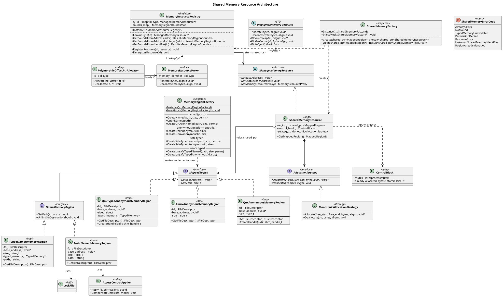

# Shared Memory Redesign

This document describes the redesigned shared memory architecture for `lib-memory`. It complements the class diagram (`memory_resource_hierarchy.puml`) and the sequence diagrams (`memory_resource_sequences.puml`) with rationale and design decisions.

## Architecture Overview

The redesign splits responsibilities into three singletons:

**MemoryRegionFactory** creates and deduplicates memory regions. It has no PMR dependencies — it's a standalone factory that returns `shared_ptr<MappedRegion>`. Direct users (those who place data in SHM without an allocator) call this directly and use the region as-is. PMR users call this first, then pass the region to SharedMemoryFactory.

**SharedMemoryFactory** wraps a region into a PMR-compatible resource. `Create()` takes a `shared_ptr<MappedRegion>`, placement-news a ControlBlock, creates a `SharedMemoryResource`, and registers it in the registry. `Open()` does the same but casts the existing ControlBlock instead of placement-new (the creator already initialized it). Both return `shared_ptr<SharedMemoryResource>`.

**MemoryResourceRegistry** is a pure lookup service. It maps resource ids to `ManagedMemoryResource*` pointers and provides bounds checking for address validation. Called on the hot path (every allocation via proxy), so it's kept separate from the factories for interface segregation.

## Memory Region Hierarchy



```text
MappedRegion (GetBaseAddress, GetSize)
  +-- NamedMemoryRegion (+ GetPath, UnlinkOnDestruction)
  |     +-- PosixNamedMemoryRegion (+ GetFileDescriptor)
  |     +-- TypedNamedMemoryRegion (+ GetFileDescriptor)
  +-- QnxAnonymousMemoryRegion (+ GetFileDescriptor, CreateHandle)
  +-- LinuxAnonymousMemoryRegion (+ GetFileDescriptor)
  +-- QnxTypedAnonymousMemoryRegion (+ GetFileDescriptor, CreateHandle)
```

Named regions have a common interface (`NamedMemoryRegion`) because POSIX defines `shm_open` with a path — this is portable.

Anonymous regions have **no common abstract class**. There is no POSIX standard for anonymous shared memory — each OS has its own mechanism:

- **QNX:** `shm_open(SHM_ANON)` → fd, shared via `shm_create_handle()` → `shm_handle_t`
- **Linux:** `memfd_create()` → fd, shared via UDS

Since the sharing mechanism differs (handle vs fd-over-socket), a common `GetHandle()` would be a leaky abstraction — the caller must know the platform to use the result. Each platform class exposes its own API directly.

## PMR Hierarchy

```text
amp::pmr::memory_resource (STL base)
  +-- ManagedMemoryResource (+ GetBaseAddress, GetUsableBaseAddress, GetMemoryResourceProxy)
        +-- SharedMemoryResource (+ GetMappedRegion)
```

`ManagedMemoryResource` is the minimal contract that the registry needs: an id and Allocate/Deallocate. `GetMappedRegion()` lives on `SharedMemoryResource` because not every `ManagedMemoryResource` necessarily has a region (interface segregation). `SharedMemoryFactory::Create()` returns `SharedMemoryResource`, not the base class.

## ControlBlock

```text
ControlBlock {
    mutex : InterprocessMutex (PTHREAD_MUTEX_ROBUST)
    already_allocated_bytes : atomic<size_t>
}
```

`SharedMemoryResource` owns and manages the ControlBlock. During `SharedMemoryFactory::Create()`, it placement-news the ControlBlock at the region's base address. The usable memory for user allocations starts at `base + ControlBlock::TotalSize()`.

The proxy id is not stored in the ControlBlock. It's stored by value in the `PolymorphicOffsetPtrAllocator` — same 8 bytes as an OffsetPtr, but avoids a pointer indirection on the hot path.

For named regions, the id is deterministic (`hash(path)`) so both creator and opener resolve to the same id in their local registries. For anonymous regions, the id is a process-local monotonic counter (no cross-process sharing by path).

Direct users never see the ControlBlock — they use `MappedRegion` directly and get the full region.

## Robust Mutex and Crash Recovery

### The problem

The `InterprocessMutex` in the ControlBlock is `PTHREAD_PROCESS_SHARED` but not `PTHREAD_MUTEX_ROBUST`. If a QM process crashes while holding the mutex, the next caller gets an error from `pthread_mutex_lock()`, and our `InterprocessMutex::lock()` calls `std::terminate()`. If that next caller is ASIL-B, we just crashed a safety-critical process because some QM process died. That's a freedom-from-interference violation.

### The fix

We set `PTHREAD_MUTEX_ROBUST` on the mutex. The kernel tracks who holds it. If that process dies, the next `pthread_mutex_lock()` returns `EOWNERDEAD` instead of deadlocking or failing.

`InterprocessMutex::lock()` returns `LockResult { Acquired, AcquiredAfterOwnerDied }`. On `EOWNERDEAD`, it calls `pthread_mutex_consistent()` internally and returns `AcquiredAfterOwnerDied` so the caller knows what happened.

### Monotonic allocator: no recovery needed

For our monotonic bump allocator, the shared state after EOWNERDEAD is always valid. The only mutable field is `already_allocated_bytes` — a single `atomic<size_t>` that only ever increases. An atomic store either happened or it didn't; there's no half-written state. If the previous holder died before the store, the old value is valid. If it died after, the new value is valid (a few bytes are wasted for an allocation nobody will use, but the allocator state is consistent).

So for monotonic, EOWNERDEAD handling is: get the lock, notice the previous owner died, continue as normal. No flags, no recovery callbacks, no strategy pattern.

```cpp
auto result = control_block_->mutex.lock_robust();
// AcquiredAfterOwnerDied? Doesn't matter -- state is always valid.

auto current = control_block_->already_allocated_bytes.load();
auto aligned = align_up(current, align);
if (aligned + bytes > usable_size_) {
    control_block_->mutex.unlock();
    std::terminate();  // OOM
}
control_block_->already_allocated_bytes.store(aligned + bytes);
control_block_->mutex.unlock();
return base + aligned;
```

Note that `do_allocate()` only bumps the counter and returns a pointer. It does not write any data. The caller writes data after getting the pointer back, and notifies consumers via LoLa. If the producer dies while writing data (after `do_allocate()` returned), the mutex is not held, the ControlBlock is consistent, and the consumer was never notified — so nobody reads the partial data.

### Future dynamic allocator

A dynamic allocator with free lists would need additional machinery because mid-mutation crashes can corrupt multi-step pointer updates. Specifically:

- An `operation_in_progress` dirty flag in the ControlBlock, set before mutation, cleared after. If the process dies mid-mutation, the flag stays true.
- An `OnOwnerDied()` recovery hook on AllocationStrategy. The dynamic strategy checks the dirty flag and returns `Corrupted` if set (free lists may be half-updated). If recovery fails, the flag is left set as a permanent corruption marker — the next normal lock sees it and returns an error.
- Both `do_allocate()` and `do_deallocate()` would need this protocol, since freeing memory also modifies the list.

Recovery logic is the strategy implementer's responsibility. The framework provides `lock_robust()` and the EOWNERDEAD signal. The strategy knows its own data structures and how to check whether they're consistent or not.

Monotonic does not need any of this because its state is a single atomic integer that only goes up.

## Allocation via Proxy (Hot Path)

The hot path for allocating in SHM from a consumer process:

1. `PolymorphicOffsetPtrAllocator::Allocate(n)` reads its `id_` (stored by value, no SHM access)
2. Calls `MemoryResourceProxy::Allocate()` which calls `MemoryResourceRegistry::LookupById(id_)`
3. Registry returns `ManagedMemoryResource*`
4. Calls `resource->Allocate(bytes, align)` which does `lock_robust()` + bump + unlock
5. Returns `OffsetPtr<T>` (offset-from-self, valid across processes mapping the same SHM)

## Region Lifecycle

**Creation**: `MemoryRegionFactory::CreateNamed(path, size, perms)` does `shm_open` + `ftruncate` + `mmap`. Returns `shared_ptr<MappedRegion>`. Dedup is handled internally — same path returns the existing region.

**Wrapping**: `SharedMemoryFactory::Create(region)` placement-news a ControlBlock, creates `SharedMemoryResource`, registers in `MemoryResourceRegistry`.

**Opening**: Another process calls `MemoryRegionFactory::OpenNamed(path)` to get a `shared_ptr<MappedRegion>`, then `SharedMemoryFactory::Open(region)` to wrap it. `Open()` casts the existing ControlBlock (no placement-new), registers in `MemoryResourceRegistry`, and returns `SharedMemoryResource`. The opener uses `GetUsableBaseAddress()` to access data past the ControlBlock — the ControlBlock is hidden from the user.

**Cleanup**: `NamedMemoryRegion::UnlinkOnDestruction(bool)` controls whether the destructor calls `shm_unlink`. The creator sets this to true. When the last `shared_ptr` dies, the destructor unmaps, closes the fd, and unlinks the SHM file. LoLa skeletons set this to false so SHM survives `PrepareOffer`/`PrepareStopOffer` cycles.

## Pool Selection

Each memory pool (Posix, Safe Typed, Unsafe Typed) has its own Create method on `MemoryRegionFactory`:

- `CreateNamed()` / `CreateQnxAnonymous()` / `CreateLinuxAnonymous()` — Posix / platform-native SHM
- `CreateSafeTypedNamed()` / `CreateSafeTypedAnonymous()` — safe physical RAM via typed memory daemon
- `CreateUnsafeTypedNamed()` / `CreateUnsafeTypedAnonymous()` — unsafe typed memory

No TypedMemory pointer in the API. No string-based pool selection. The method name encodes the pool. Each method takes exactly the parameters that pool needs.

## Error Handling

Recoverable errors are returned via `bmw::Result<T>`:

- `AlreadyExists` — SHM already exists, call `OpenNamed`
- `NotFound` — SHM doesn't exist, call `CreateNamed`
- `TypedMemoryUnavailable` — typed memory daemon not running, fall back to Posix
- `PermissionDenied` — check ACL configuration
- `ResourceBusy` — retry
- `RegionAlreadyManaged` — region already wrapped by SharedMemoryFactory

Fatal errors (mmap failure, ftruncate failure, OOM, lock timeout) call `std::terminate()`. These are not recoverable at runtime.

## Sequence Diagrams

The sequence diagrams cover 9 flows:

### 1. Direct user CreateNamed (Posix)

Simplest path, no PMR.


### 2. PMR creator CreateNamed (Posix)

Region + SharedMemoryFactory + allocation.


### 3. Opener OpenNamed

Another process opens existing SHM via SharedMemoryFactory::Open.


### 4. PMR creator CreateSafeTypedNamed

Typed memory daemon path.


### 5. PMR creator CreateQnxAnonymous

QNX anonymous region (SHM_ANON) + fd sharing.


### 6. PMR creator CreateSafeTypedAnonymous

QNX typed anonymous memory via daemon.


### 7. Allocation in creator process (hot path)

lock_robust + bump + robust mutex recovery.


### 8. Dedup hit

Same path returns existing region from factory's internal map.


### 9. Destruction

Resource and region cleanup, shm_unlink via UnlinkOnDestruction.


## Design Decisions

| Decision | Rationale |
|----------|-----------|
| Three singletons (not one) | Interface segregation. Registry is hot-path, factory is cold-path. Direct users only need MemoryRegionFactory. |
| Proxy id by value in allocator | No pointer indirection on hot path. |
| No GetFileDescriptor on MappedRegion base | Only subclasses that have an fd expose it. |
| No AnonymousMemoryRegion abstract class | No POSIX standard for anonymous SHM. QNX and Linux have different APIs — a common GetHandle() would be a leaky abstraction. |
| Opener uses SharedMemoryFactory::Open | ControlBlock encapsulation — opener gets GetUsableBaseAddress() without knowing ControlBlock layout. |
| Method name encodes pool | No TypedMemory* in API. No string parsing. Each method takes exactly what it needs. |
| UnlinkOnDestruction instead of Remove API | RAII cleanup. No dangerous Remove() that can pull SHM from under other processes. |
| Robust mutex for ASIL-B | PTHREAD_MUTEX_ROBUST. Monotonic: just continue after EOWNERDEAD. No extra flags needed. |
| Dynamic recovery is strategy's job | Framework provides lock() and EOWNERDEAD. Strategy implementer handles recovery logic for their own data structures. |
