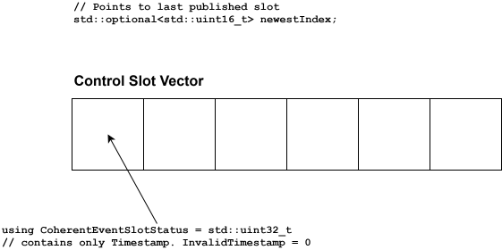

# Nautilus Communication Patterns

## Current Design

### Activity lifecycle

An activity in the Nautilus sense is a user provided class inheriting from a Nautilus activity base class. Its main
entry-points a user has to implement are:

- `Init()`: Called once in the beginning.
- `ExecuteStep()`: Called cyclically ba a "scheduler"

In `Init()` the user activity registers:

- for each topic it wants to consume: A callback being called by Nautilus before the next scheduled execution-step
  happens. There are currently two different callback-types/signatures supported, with different semantics.
- for each topic it wants to produce: A callback being called by Nautilus after an execution-step finished. There are
  currently three different callback-types/signatures supported, with different semantics. One of them with (worst
  performance) is already deprecated. Then two remain, where the latter is "experimental", but the way to go forward.

Before `ExecuteStep()` of the user activity gets called, the registered sample-receive callback get called.

## Future Design

### Activity lifecycle

This will basically stay the same. Since we restrict sample-receive and sample-publish callbacks to one type for each,
also the pattern, when the callbacks will be called in the life-cycle changes:

- receive-sample callbacks will be called only once after `Init()`, before the first call to `ExecuteStep()`. They get
  an instance of a wrapper class, which provides access to received samples. This instance shall be stored by the
  activity and used during `ExecuteStep()`.
- publish-sample callbacks will be called only once after `Init()`, before the first call to `ExecuteStep()`. They get
  an instance of a wrapper class, which provides access to an API to publish a sample. This instance shall be stored by
  the activity and used during `ExecuteStep()`.

### Receive Callbacks

The single receive-callback signature we now support is basically today's variant with the
`LifetimeBoundedMessage<MessageType>`
call argument. I.e. the argument is an instance of a wrapper class, which provides the following functionalities:

- A consume/dereference API, which provides a pointer to a received sample.
- Since activities need to declare, in how many samples they are interested, the wrapper takes this into account, I.e.
  it allows up to N consume/dereference calls.
- it is expected, that the user activity stores this wrapper and accesses/uses it only within `ExecuteStep()`.

### Publish Callbacks

The single publish-callback signature we now support is basically today's `ZeroCopyPublisher` variant, which is
"experimental". It has a single call argument, which is an instance of a wrapper class, which provides the following
functionalities:

- An `Allocate()` API, which returns on success a pointer abstraction to a buffer, where the topic-sample can be
  published.
- A `Send()` API, where the pointer abstraction returned from `Allocate()` is handed over again, to document, that
  publishing has been finished.
- it is expected, that the user activity stores this wrapper and accesses/uses it only within `ExecuteStep()`.

The semantics with `Allocate()`/`Publish()` (and the pointer abstraction returned from `Allocate()`) is almost identical
to `score::mw::com`.

### Communication variants

Depending on the deployment of the activities, which exchange topic-samples, we have three different setups.

#### Purely Intra-Chain

A topic-sample produced by a publishing activity is solely consumed by activities within the same activity chain. Note,
that activities within the same activity chain can reside in different processes. This is the most effective variant as
the Nautilus framework (scheduling) cares for the following:

- All producers `ExecuteStep()` functions are called before `ExecuteStep()` functions of consumer activities for a given
  topic.
- There is no concurrency between a producer and a consumer

Therefore, no synchronization is needed. The producer publish their topic-sample into a pre-sized/pre-allocated "queue"
in shared-memory. Eventually several samples per `ExecuteStep()`. The consumers read from the very same "queue".

Behind the publish/receive wrappers the activities use, we will deploy an optimized `LoLa` binding for `score::mw::com`.
For now, we call it `Coherent LoLa`. Since there is no concurrency at all, we can use a much simpler data structure in
the CONTROL segment. No atomics/compare-exchange and slot search is needed.

The data structure in the CONTROL segment has - like standard `LoLa` - a control slot vector, with a
`CoherentEventSlotStatus`
per slot, which only contains a timestamp, thus has only 4 byte size. Additionally, we have one variable `newestIndex`,
which is an `optional` marking the index of the last published sample. It is an `optional` as initially there is nothing
published. The "optimization", that a `CoherentEventSlotStatus` is only 4 byte in size over the standard `LoLa`
`EventSlotStatus`, which is 8 byte in size, might be a slight performance improvement of larger control slot vectors, as
the control segment is smaller and thus more likely to be in cache.

##### Publishing Steps

- when the publisher calls `Allocate()`, this boils down to an `Allocate()` call in `Coherent LoLa`:
    - It checks the value of `newestIndex`.
        - If it has no value yet, the call returns a lola::coherent::AllocateePtr<void>
          pointing to slot with index 0
        - otherwise it returns a lola::coherent::AllocateePtr<void>
          pointing to slot with index `newestIndex`.value ()++ - doing a wraparound in case it would exceed max slot
          index. I.e. the slot-vector is handled like a ringbuffer.
- the publisher then writes the event data to the slot, where `lola::coherent::SampleAllocateePtr<void>` points to.
- finally the publisher then calls Publish (allocateePtr). This boils down to a
  `Send(lola::coherent::SampleAllocateePtr<void>)`
  call in `Coherent LoLa`:
    - it increments `newestIndex` to the index the AllocateePtr points to and sets the `CoherentEventSlotStatus` to the
      current timestamp incremented by one.

##### Consuming Steps

Before the Nautilus framework calls `ExecuteStep()` for the consumer activity, which has announced the maximum number of
topic samples Nmax it can process, it calls `GetNewSamples(callback, Nmax)` in `Coherent LoLa`:

- It checks the value of `newestIndex`.
    - If it has no value yet, it does not call the callback and returns 0.
    - otherwise it goes back from `newestIndex` in the control slots until it finds a `CoherentEventSlotStatus`, which
      timestamp is older (smaller) or equal to the timestamp of the last `GetNewSamples()` call or until Nmax
      is reached. Whatever happens first.
- Then it calls the callback for each sample in ascending order from the last checked slot til the slot with
  `newestIndex`. The callback gets a `lola::coherent::SamplePtr<void>`, which encapsulates a simple pointer to the data
  slot.

**Important**: Since the consumer does not change any shared state in the CONTROL segment, there is no need for the
consumer to write a transaction log entry!

#### Purely Inter-Chain

A topic-sample produced by a publishing activity is solely consumed by activities in different activity chains. Since
there is no synchronization between activities from different activity chains in the sense of a controlled execution
sequence, producing and consuming activities may run concurrently. Therefore, we need to use the standard LoLa binding
for communication, which provides the needed strong synchronization guarantees. No adaptions (apart from general
performance optimizations) are needed. Runtimes for:

- Provider, allocating and sending a topic sample via SkeletonEvent::Allocate/Send`
- Consumer, retrieving new topic samples via `ProxyEvent::GetNewSamples()`

are higher than for the `Coherent LoLa` binding, as the control data structure is more complex and needs to be
synchronized.

#### Mixed Intra/Inter-Chain

A topic-sample produced by a publishing activity is consumed by activities in the **same or different** activity chains.
To support this, there are three options to implement this:

1. The producer activity uses the standard LoLa binding for communication, which provides the needed strong
   synchronization guarantees. The consumers in different activity chains can then use the standard LoLa binding for
   communication.
2. The producer activity uses the `Coherent LoLa` binding for communication, to serve the consumers in the same activity
   chain. For the consumers in different activity chains, a second publisher activity is used, which uses the standard
   LoLa binding for communication. Topic samples are copied from the first publisher to the second publisher. In this
   case the 2nd publisher activity is at the same time a consuming activity, thereby using `Coherent LoLa` binding.
3. We introduce a new binding, which is a combination of `Coherent LoLa` and `Standard LoLa`.

We vote for option 3 with the following reasoning:

We expext, that the mixed intra/inter-chain communication pattern will be used very frequently. Therefore, we should
optimize for this case.

- Option 1 is no optimization at all! I.e. we do not take any advantage of the fact, that we have a set of consumers,
  which do not need any synchronization. Thus, even these consumers will have to pay the price of the more complex
  control data structure and synchronization.
- Option 2 requires the cost of a sample copy (which might have an impact for huge topic sample sizes) plus the
  additional runtime costs for allocation being done by the 2nd publisher activity using standard `LoLa`.
- Option 3 (we called `Mixed LoLa` for now) spares the sample copy and only adds the runtime overhead for the
  allocation.

So here is, what `Mixed LoLa` adds or changes:
The data structure in the CONTROL segment is the same as in `Standard LoLa`. I.e. the slots have the same 64bit
`EventSlotStatus`, which contains timestamp and control info. What we **add** from the `Coherent LoLa` is the variable
`newestIndex`. It will help coherent consumers to speed up their `GetNewSamples()` call.

##### Publishing Steps

- when the publisher calls `Allocate()`, this boils down to an `Allocate()` call in `Mixed LoLa`:
    - It behaves exactly like `Standard LoLa`, when searching for a free slot and claiming it via atomic-change to
      `IN_WRITING`.
- the publisher then writes the event data to the slot, where `lola::SampleAllocateePtr<void>` points to. So, we use the
  same SampleAllocateePtr as `Standard LoLa`.
- finally the publisher then calls `Publish(allocateePtr)`. This boils down to a
  `Send(lola::SampleAllocateePtr<void>)` call in `Mixed LoLa`:
    - it does the same atomic status change like `Standard LoLa` does.
    - it additionally sets `newestIndex` to the index the AllocateePtr points to. This gives later the coherent
      consumers a better starting point for their `GetNewSamples()` search.

##### Consuming Steps for coherent consumer

- before the Nautilus framework calls `ExecuteStep()` for the consumer activity, which has announced the maximum number
  of topic samples Nmax it can process, it calls `GetNewSamples(callback, Nmax)` in `Mixed LoLa`:
    - It checks the value of `newestIndex`.
        - If it has no value yet, it does not call the callback and returns 0.
        - otherwise it starts from `newestIndex` in the control slots to check, whether timestamp is newer than the last
          time, GetNewSamples has been called. The initial sample, where `newestIndex` pointed to will be the newest
          sample reported via callback (and therefore being reported last). It stopps the search in any of these cases:
            - it reached the `newestIndex` again after ringbuffer like wrap-around. (Nmax samples might or
              might not have been found)
            - It already found Nmax samples having a timestamp newer than the last time GetNewSamples was
              called **and**
              the timestamps of these samples (the one with `newestIndex` having the highest) are dense/have no holes.
              In this case the search can also be prematurely stopped without looking at remaining samples.
        - Then it calls the callback for each sample sorted in ascending order from the oldest timestamp to the newest,
          which is the one of `newestIndex`. The callback gets a `lola::coherent::SamplePtr<void>`, which encapsulates a
          simple pointer to the data slot.

##### Consuming Steps for non-coherent consumer

- before the Nautilus framework calls `ExecuteStep()` for the consumer activity, which has announced the maximum number
  of topic samples Nmax it can process, it calls `GetNewSamples(callback, Nmax)` in `Mixed LoLa`, but in
  non-coherent mode:
    - the implementation of `GetNewSamples(callback, Nmax)` in `Mixed LoLa` in non-coherent mode is exactly the same as
      in `Standard LoLa`. We only need some minor distinction as the layout/structure of the CONTROL data structure
      looks slightly different, because of `newestIndex`.

### Solution Summary

We will extend the existing LoLa binding to support different strategies in the CONTROL data structure, which are
optimized for different communication patterns.

- the event and field deployment for `LoLa` service instance deployments (`"binding": "SHM"`) gets extended with a new
  property `coherency`, which can be set to `COHERENT` or `NON_COHERENT` or `MIXED`. The default is `NON_COHERENT`,
  which is the current behavior of `LoLa`.
- only on the provider side, the value `MIXED` is supported. On the consumer side, only `COHERENT` or `NON_COHERENT`
  is supported.
- Depending on what `coherency` the provider has set, the layout of the CONTROL data structure is different. Which
  layout has been chosen by the provider is published in the CONTROL section. A consumer can then check, whether the
  `coherency` of the provider is compatible with its own expectation:
  A consumer with `COHERENT`, requires a provider, which has either chosen to provide `COHERENT` or `MIXED` coherency. A
  consumer with `NON_COHERENT`, requires a provider, which has either chosen to provide `NON_COHERENT` or `MIXED`
  coherency.

#### Init

The difference in `Init()` will be:

For the registration of receive-callbacks, we only support one signature. This roughly represents, what is today the
callback signature getting the new received topic sample in the form of a `LifetimeBoundedMessage<MessageType>`.
`LifetimeBoundedMessage<MessageType>` is a small wrapper around a pointer/reference to the sample data. I.e.
`LifetimeBoundedMessage<MessageType>` does not apply any copying. It just does minimal sanity checks. E.g. supervising,
that access to the sample does not take place outside the step lifecycle.
