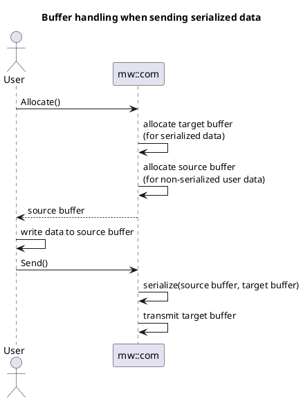
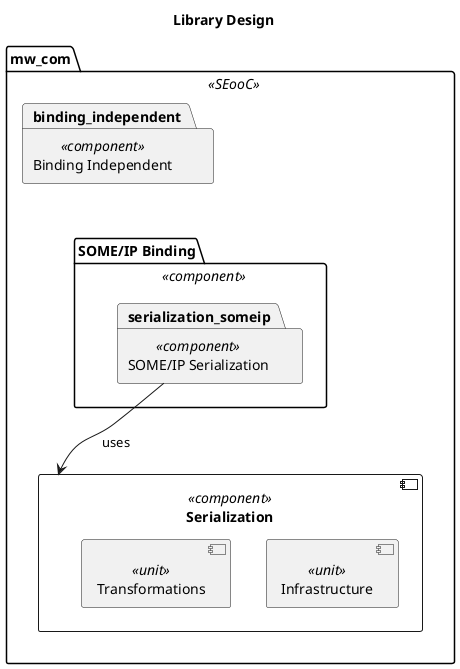
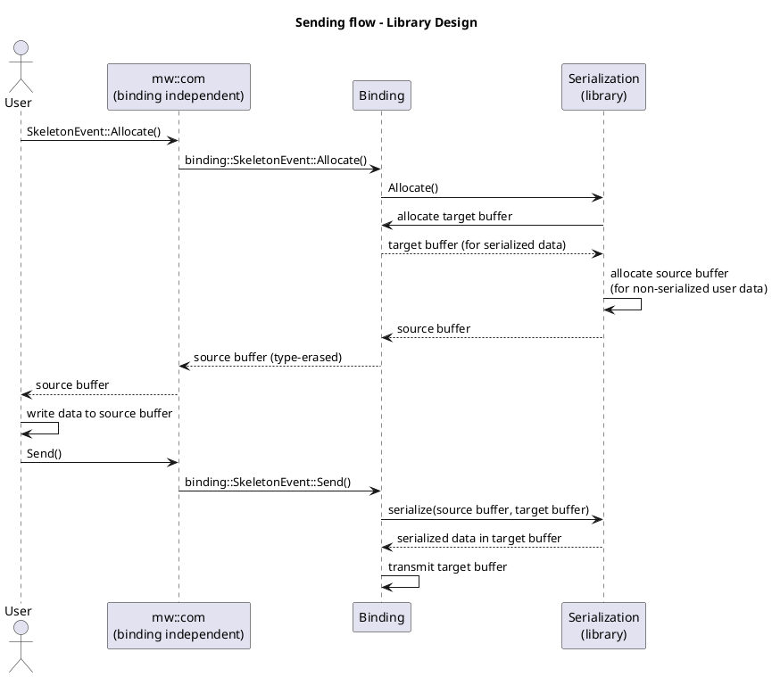
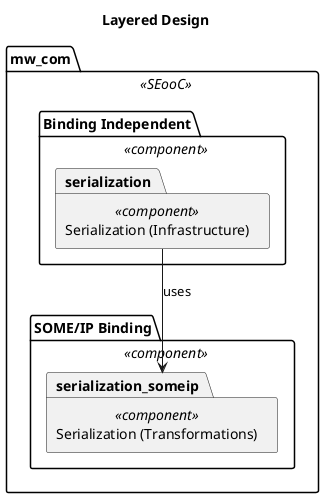
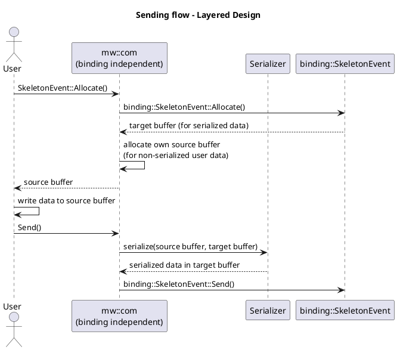
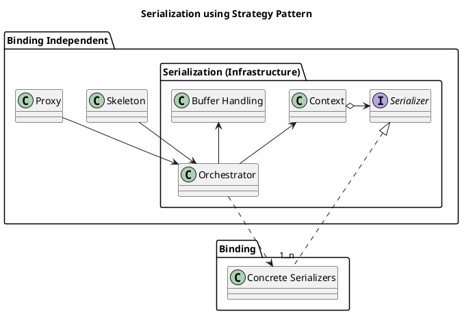
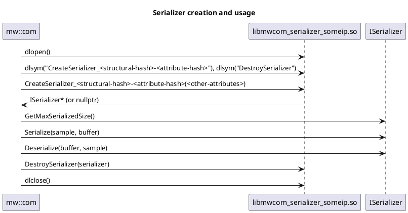

<!-- ----------------------------------------------------------------------------
  Copyright (c) 2026 Contributors to the Eclipse Foundation

  See the NOTICE file(s) distributed with this work for additional
  information regarding copyright ownership.

  This program and the accompanying materials are made available under the
  terms of the Apache License Version 2.0 which is available at
  https://www.apache.org/licenses/LICENSE-2.0

  SPDX-License-Identifier: Apache-2.0
----------------------------------------------------------------------------- -->

# Serialization

As basis to understand the serialization framework, one must understand, that serialization is applied when one cannot
guarantee that the data layout on both ends of the communication channel matches.
The solution is to transfer the data via serialization to a known and by both parties agreed upon format.
Then the recipient can deserialize the data into their own internal representation.

This means, that full zero-copy schemes fall apart when serialization comes into play.
Both steps perform a relayout of the data in memory, which involves the source buffer with the data and a target buffer
for the serialized data.

The following generic sequence shows the resulting buffer handling on the sending side, independent of the
architectural design (see the design variants below for the concrete flows):



For the communication framework that performs serialization on the fly (when required), this means additional buffer
handling must be implemented to support the serialization process.
This buffer handling is not defined by the serialization algorithm, but rather by the public API of the communication
framework.
A user of the framework shall not be aware of the binding selected for communication.
E.g. the data layout and APIs are always the exact same, regardless of the binding selected.

This means each binding would reimplement the buffer handling logic to perfectly match other bindings.
Therefore, this buffer handling is independent of the serialization format used.

## Architectural Split of the Serialization Framework

Thus, we split the serialization framework into two parts, one that is generic (infrastructure),
and one that is specific to the serialization format used (transformation).

This allows us to reuse the infrastructure for any serialization format, while we implement the specific transformations
for each format separately.

This enables two basic architectural designs for the infrastructure part:

**Library Design**



The buffer handling could be designed as a library that is linked into the binding(s) that require serialization.
This would ensure that the code must not be duplicated while we encapsulate the full serialization in the binding.

Sending flow in the library design: the binding invokes the library, which allocates the source buffer itself, while
the target buffer is provided by the binding.



But, the instantiation and usage of the library would still involve surrounding boilerplate code.
This means the risk of different bindings changing the public API of mw::com is not mitigated.
Further, the binding is type-erased, which makes a safe serialization framework difficult to implement.

Therefore, we opt for the second design, which is a layered design.

**Layered Design**



Since the buffer handling is independent of the serialization format, it can be implemented in the binding-independent
frontend layer.
This ensures no surrounding boilerplate code in the binding(s) and guarantees type safety.

Further, only the binding-independent frontend layer is strongly typed.
This greatly simplifies the implementation of a serialization framework with high safety standards.

Thus, the generic part must reside in the binding-independent frontend layer, while the other parts must reside in the
binding(s).

Sending flow in the layered design:



It is important to note, that the selection of a binding happens at deployment time.
This means, that at compile time it is unclear which binding and therefore which serialization format will be used.
In other words, the transformation part is a runtime strategy decision that is made based on the selected binding.
See a description of the [Strategy Pattern](https://refactoring.guru/design-patterns/strategy).



We also reflect this in our binary artifacts.
Serializers will not be stored in the binary of the application.
Instead, we load them dynamically at runtime.

## Selecting a Serializer

It is imperative, that the correct serializer is loaded based on the type of the data to be serialized.
But, bindings may have additional inputs that influence the transformation logic.
E.g. SOME/IP allows specification of the endianness per event/field/...
So selecting the serializer solely based on the data type is insufficient.

This brings us to three possible approaches:

1. Selection of the serializer is fully based on compile time information.
2. Selection of the serializer is fully based on runtime information.
3. Selection of the serializer is split between compile time and runtime.

Option 1 leads to an explosion of the number of compiled serializers or restricts the capability to meaningfully use
deployment configuration.
Therefore, we discard this option.

Option 2 would make it infeasible to verify a match of service interface and serializer via the C++ type system.
Thus, we have a safety risk, that a user may select an incompatible serializer and causes undefined behavior.

Option 3 combines the two bookends of the spectrum, to mitigate the drawbacks of both.
At compile time we fix (at least) the data type, while at runtime we focus on additional inputs that influence
the transformation logic. This ensures type safety and keeps binary sizes manageable.

### Type Safety of Serializers

Since dynamically loading symbols loses type safety, we use a fingerprint on both sides (application and library)
to ensure that a matching serializer is selected.
In the application the service interface elements contain next to the data type a matching fingerprint.

It is up to the user to ensure that data type and fingerprint match.
Using a generator can give an automated guarantee based on data from an ECU model.

This `structural-hash` (fingerprint) is used in the lookup of the serializer.

### Serializer Attributes

For every attribute that reflects the runtime selection of a serializer, we have two potential choices to match it to
a serializer

1. The attribute is fixed in the serializer at compile time.
   The runtime selection is restricted to a subset of possible values by the set of available serializers in the binary.
2. The attribute is used to configure the serializer at runtime.
   This has a performance penalty because of increased branching within the serializer but allows full flexibility in
   the configuration.

We intentionally foresee both options in our solution, since it is dangerous to decide strictly for one approach without
data to evaluate the impact on binary sizes and performance in realistic scenarios.

The attributes fixed at compile time of the serializer are combined to an `attribute-hash`.

## Serializer API

Since Serializers are dynamically loaded, the public API is restricted to FFI compatible language parts.

This mainly means the following restrictions for us:

1. ABI compatibility must be ensured
2. Allocation and deallocation must happen on the same side of the FFI boundary
3. Construction and destruction of objects must happen on the same side of the FFI boundary
4. Avoid exceptions
5. Avoid static initialization and thread-local variables

We take several assumptions:

1. All involved binaries are built using the same toolchain with equal configuration influencing ABI layout.
2. Dynamically loaded symbols are exposed without name mangling (`extern "C"`)

These assumptions allow us to use C++ features for the public API of serializers. We are mainly interested in using
the object-oriented programming style.

### ISerializer Interface

Every generated library provides one implementation of `ISerializer` per datatype:

```cpp
class ISerializer
{
  public:
    virtual score::Result<std::size_t> Serialize(const void* sample, score::cpp::span<std::uint8_t> buffer) const noexcept = 0;
    virtual score::Result<void> Deserialize(score::cpp::span<const std::uint8_t> buffer, void* sample) const noexcept = 0;
    virtual score::Result<std::size_t> GetMaxSerializedSize() const noexcept = 0;
};
```

* The sample is passed type-erased (`void*`).
  Type safety is not provided by the interface itself but by the structural hash used for the lookup
  (see [Type Safety of Serializers](#type-safety-of-serializers)).
* `GetMaxSerializedSize()` returns the worst-case serialized size.
  The binding-independent layer can use it to size the target buffer requested from the binding
  (see the sending flows above), since the serializer is not aware of the transport.
* `Serialize()` returns the number of bytes written to the buffer or an error.
* All methods are `noexcept` and report failures via `score::Result` instead of exceptions.
  This keeps the ABI free from exception handling across the library boundary.
* The methods are `const`, so a single instance can be shared by all samples of one event/field.

Errors are reported with the error domain `SerializerErrc`:

| Error                    | Meaning                                                  |
|--------------------------|----------------------------------------------------------|
| `kBufferTooSmall`        | The target buffer cannot hold the serialized data.|
| `kBufferTooLarge`        | The input buffer is larger than expected.                |
| `kDeserializationFailed` | The input buffer is malformed or truncated.|
| `kCreationFailed`        | The serializer could not be created.|
| `kInvalidArgument`       | An invalid argument (e.g. `nullptr` sample) was passed.|
| `kInternalError`         | Any other internal error (e.g. a length limit exceeded).|

### Factory Functions

Since the dynamic loader only sees symbols, we require a factory pattern to construct the serializer objects.
To simplify the serializer lookup, we provide a factory function for each serializer variant, following this pattern:

```cpp
ISerializer* CreateSerializer_<structural-hash>_<attribute-hash>(<other-attributes>) noexcept;
```

where `<other-attributes>` represents the attributes fixed at runtime.

If the symbol is not found, or `CreateSerializer_...` returns a heap-allocated serializer, or `nullptr` if the construction fails.
mw::com maps `nullptr` to a failed creation of the Proxy/Skeleton.

The caller owns the serializer and must release it with `DestroySerializer`, so that allocation and deallocation
happen on the same side of the library boundary.

```cpp
void DestroySerializer(ISerializer* serializer) noexcept;
```

It is highly recommended to store the serializer immediately in a `std::unique_ptr` with custom deleter.



### Public API Stability

To keep API compatibility, the `structural-hash` can at best be optional in the service interface.
This means, we potentially lack this hash when a user selects a binding that requires serialization.

In this case we can either fail creation of the Proxy/Skeleton.
Or, we provide a fallback option, that allows a user to define this hash in the deployment configuration.

If this fallback option is used, a warning must be issued, that type safety cannot be guaranteed any longer.
