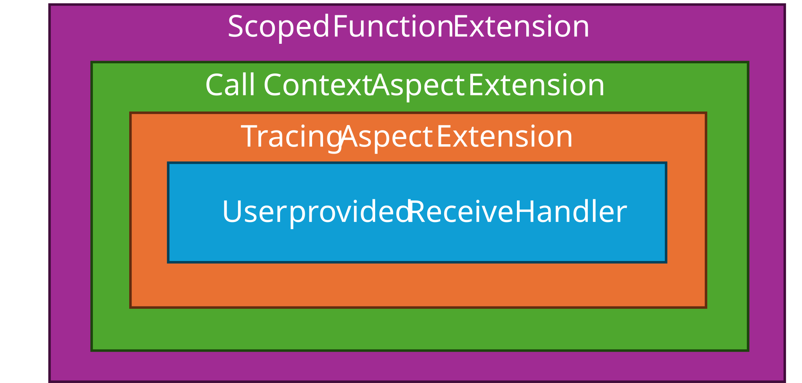

# Binding-Independent Proxy Event Unit Design

## Event/Field communication in `LoLa`

The field implementation on the proxy side looks similar to the skeleton side: We have `impl::ProxyField<SampleType>`
class template (just like `impl::SkeletonField<SampleType>`), but in this case there is no base class!
`impl::ProxyField<SampleType>` directly aggregates the event specific dispatch target with its member
`proxy_event_dispatch_` of type `impl::ProxyEvent<SampleType>`.

### Proxy side Activities for Event Access

The central API entry point at proxy/consumer side to access event samples (after a successful subscription) is the
`GetNewSamples()` method of an event instance. The activities taken by the proxy side implementation are as follows:

The activity shown above thereby relies on activity `ReferenceNextEvent`, which is shown here:

The main proxy algorithm above the shared memory data structures is broken into three entities:
`score::mw::com::impl::lola::ProxyEvent`, `score::mw::com::impl::lola::ProxyEventCommon` and `score::mw::com::impl::lola::SlotCollector`.
While `ProxyEvent` is a type-aware templated class, `ProxyEventCommon` and `SlotCollector` are both type-agnostic. All ProxyEvent
functionality that doesn't require awareness of the type or direct interaction with shared memory are dispatched from `ProxyEvent`
to `ProxyEventCommon`. `SlotCollector` operates on the shared memory control structure without knowledge of the actual type,
using `ConsumerEventDataControlLocalView` to avoid `OffsetPtr` overhead on the hot-path.
`ProxyEvent` implements the functionality (including direct interaction with shared memory) that require awareness of the type.
Making `ProxyEventCommon` and `SlotCollector` type-agnostic results in a slight build time benefit since type-agnostic code doesn't
need to be instantiated-then-merged by the build toolchain as this would be the case if that code was part of the templated class.

#### Managing user provided EventReceiveHandlers

The "Event Update Notification" pictured above in the sequence diagram starts from the point, where the user registers
an `EventReceiveHandler` via `ProxyEvent::SetReceiveHandler`. The user provided `EventReceiveHandler` is an
`score::cpp::callback<void(void)>`, i.e. a "move-only" void callable.

`mw::com` stores this `EventReceiveHandler` in the binding independent ProxyEvent class
(`mw::com::impl::ProxyEventBase`) as member `receive_handler_ptr_`. It does **not** directly store/move it there, but
does the following adaptions:

1. It wraps the `mw::com::impl::ReceiveHandler` eventually into another `score::cpp::callback<void(void)>`, which calls the
   user provided handler and adds [IPC tracing related extensions](../ipc_tracing/README.md#handling-trace-calls). This
   pattern is not `EventReceiveHandler` specific, but is mentioned here for completeness.
2. Then it wraps the handler from (1) (which is either the original `EventReceiveHandler` provided by the user or the
   tracing-enriched version) in an extended handler, which adds an aspect of tracking the current call context. Why this
   is needed is explained [hre](#handler-extension-with-call-context-tracking).
3. Then it wraps the `mw::com::impl::ReceiveHandler` from (2) into a
   [ScopedFunction](../../../../language/safecpp/scoped_function/README.md) `ScopedEventReceiveHandler`, where the scope
   is bound to `mw::com::impl::ProxyEventBase::receive_handler_scope_`

So the resulting handler/callable is basically a composition, which looks like this:

This handler gets then stored within member `receive_handler_ptr_` as a `std::shared_ptr<ScopedEventReceiveHandler>`,
before it gets handed down to the binding specific layer in the form of a `std::weak_ptr<ScopedEventReceiveHandler>`.

Following the explanation, why the different encapsulations/extensions of the user provided
`mw::com::impl::ReceiveHandler` are done and what the `shared_ptr`/`weak_ptr` mechanism adds to the design:

##### Handler extension with call context tracking

We need to handle a call to `ProxyEvent::UnsetReceiveHandler` (or `ProxyEvent::Unsubscribe`, which implicitly also
unsets the `EventReceiveHandler`) **differently** when it is called by the user **within** his provided
`EventReceiveHandler` or **outside**!
Reasoning: When the call to `ProxyEvent::UnsetReceiveHandler` happens outside, then this call 1st must synchronize with
an eventually currently running call by expiring its scope (see next subchapter). And only after it has expired/the call
has ended, the handler can be removed/unset. This is, because we have this contract to the caller of
`ProxyEvent::UnsetReceiveHandler()`, that this function only returns after an eventually running invocation of an
`EventReceiveHandler` has ended.
When the call to `ProxyEvent::UnsetReceiveHandler` happens inside a running `EventReceiveHandler`, then synchronization
via scope expiring is not needed and would lead to a **deadlock**!
The distinction is realized via a thread local bool variable `is_in_receive_handler_context` in `ProxyEventBase`.
So in this wrapping step, we "enrich" the existing handler, by setting this thread local variable to `true`, before the
call to the handler and reset it to `false` after the handler returns. With this extension we always can find out in a
call to `ProxyEvent::UnsetReceiveHandler`, whether we are inside or outside a running `EventReceiveHandler` and act
accordingly.

##### Handler extension with scoping

As already mentioned above, we need to add a scope to the user provided `EventReceiveHandler`, where it is allowed to
run at all!
This is done by wrapping the already enriched handler within a scoped function (`ScopedEventReceiveHandler`). The
scope (`safecpp::Scope<>`) here is the member variable `receive_handler_scope_` of `ProxyEventBase`. This provides two
possibilities:

1. If the `ProxyEventBase` gets destroyed, we automatically synchronize the destruction with an eventually running
   handler, which is essential as we don't want a handler being called/running, when the underlying `ProxyEventBase` is
   already destroyed/in destruction.
2. We can explicitly expire an existing handler when unsetting/preparing to reset it.

#### shared_ptr/weak_ptr approach for the Handler

We want the binding independent layer to own the user provided `EventReceiveHandler` handed over in calls to
`impl::ProxyEvent::SetReceiveHandler`. Since `EventReceiveHandler` is move-only, the ownership is already given for this
call. But the event, which triggers the call to this handler (an event update done on provider side) happens on the
binding specific level. In the `LoLa` binding case, when the [Event Update Notification](#event-update-notification)
takes place via `message_passing`. So the binding independent layer has to forward the user provided
`EventReceiveHandler` to the binding layer to enable it to call it. Since `EventReceiveHandler` is move-only, this would
take away the ownership from the binding independent layer! If we would later implement multi-binding, this is not
acceptable.
Therefore, the binding independent `impl::ProxyEventBase` stores `EventReceiveHandler` in member `receive_handler_ptr_`
wrapped into a `shared_ptr` and hands down a `weak_ptr` created from it to the binding layer. The added benefit:
Updating/removing the `shared_ptr` on the binding independent layer needs no explicit synchronization with the binding
layer: The binding independent part can simple delete/reassign the shared_ptr and the binding layer either has a
temporary copy of the `shared_ptr` for the time it has to call the handler, or it wasn't able to lock the `weak_ptr` and
then simply skips the call.

## Update of Event sample and access via Polling

With the information shared above, we now can have a look, how the entire sequence to access new/updated event samples
looks like! This sequence builds on message passing concepts/sequences already discussed in
[Notifications between skeleton and proxy](#notifications-between-skeleton-and-proxy) and the design of data-structures
placed in shared memory discussed [here](#event-related-datastructures-in-lola-binding)

