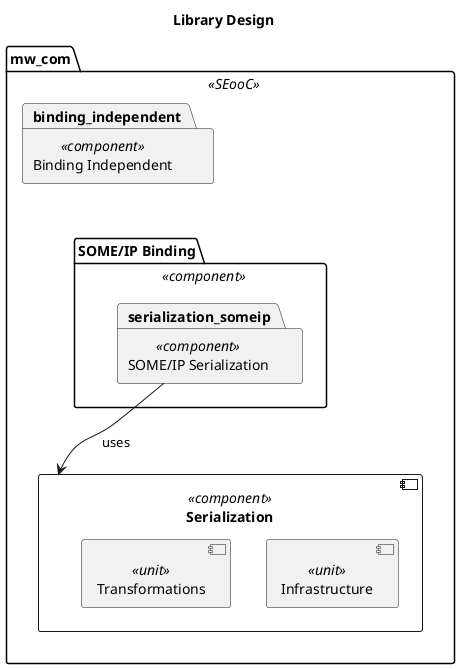
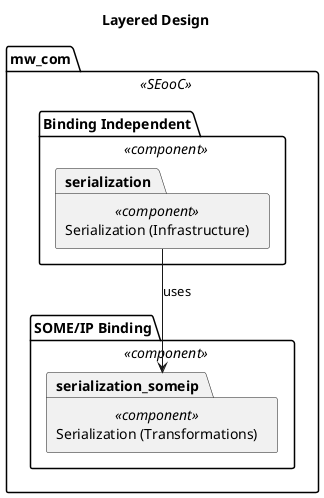
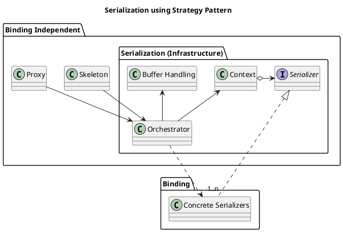

# Serialization

As basis to understand the serialization framework, one must understand, that serialization is applied when one cannot
guarantee that the data layout on both ends of the communication channel matches.
The solution is to transfer the data via serialization to a known and by both parties agreed upon format.
Then the recipient can deserialize the data into their own internal representation.

This means, that full zero-copy schemes fall apart when serialization comes into play.
Both steps perform a relayout of the data in memory, which involves the source buffer with the data and a target buffer
for the serialized data.

For the communication framework that performs serialization on the fly (when required), this means additional buffer
handling must be implemented to support the serialization process.
This buffer handling is not defined by the serialization algorithm, but rather by the public API of the communication
framework.
A user of the framework shall not be aware of the binding selected for communication.
E.g. the data layout and APIs are always the exact same, regardless of the binding selected.

This means each binding would reimplement the buffer handling logic to perfectly match other bindings.
Therefore, this buffer handling is independent of the serialization format used.

## Architectural Split of the Serialization Framework

Thus, we split the serialization framework into two parts, one that is generic (infrastructure),
and one that is specific to the serialization format used (transformation).

This allows us to reuse the infrastructure for any serialization format, while we implement the specific transformations
for each format separately.

This enables two basic architectural designs for the infrastructure part:

**Library Design**



The buffer handling could be designed as a library that is linked into the binding(s) that require serialization.
This would ensure that the code must not be duplicated while we encapsulate the full serialization in the binding.

But, the instantiation and usage of the library would still involve surrounding boilerplate code.
This means the risk of different bindings changing the public API of mw::com is not really mitigated.
<!-- TODO add some pseudo code to illustrate this. -->
Further, the binding is type-erased, which makes a safe serialization framework tremendously difficult to implement.

Therefore, we opt more for the second design, which is a layered design.

**Layered Design**



Since the buffer handling is independent of the serialization format, it can be implemented in the binding-independent
frontend layer.
This ensures no surrounding boilerplate code in the binding(s) and guarantees type safety.

Further, only the binding-independent frontend layer is strongly typed.
This greatly simplifies the implementation of a serialization framework with high safety standards.

Thus, the generic part must reside in the binding-independent frontend layer, while the other parts must reside in the
binding(s).

It is important to note, that the selection of a binding happens at deployment time.
This means, that at compile time it is unclear which binding and therefore which serialization format will be used.
In other words, the transformation part is a runtime strategy decision that is made by based on the selected binding.
See a description of the [Strategy Pattern](https://refactoring.guru/design-patterns/strategy).



We also reflect this in our binary artifacts.
Serializers will not be stored in the binary of the application.
Instead, we load them dynamically at runtime.

## Configuration of the Serializer

It is imperative, that the correct serializer is loaded based on the type of the data to be serialized.
But, bindings may have additional inputs that influence the transformation logic.
E.g. SOME/IP allows specification of the endianness per event/field/...
So selecting the serializer solely based on the data type is insufficient.

This brings us to three possible approaches:

1. Selection of the serializer is fully based on compile time information.
2. Selection of the serializer is fully based on runtime information.
3. Selection of the serializer is split between compile time and runtime.

Option 1 leads to an explosion of the number of compiled serializers or restricts the capability to meaningfully use
deployment configuration.
Therefore, we discard this option.

Option 2 would make it infeasible to verify a match of service interface and serializer via the C++ type system.
Thus, we have a safety risk, that a user may select and incompatible serializer and causes undefined behavior.

Option 3 combines the two bookends of the spectrum, to mitigate the drawbacks of both.
At compile time we fix (at least) the data type, while at runtime we focus on additional inputs that influence
the transformation logic. This ensures type safety and keeps binary sizes manageable. 

### Type Safety of Serializers

Since dynamically loading symbols looses type safety, we use a structural hash on both sides (application and library)
to ensure that a matching serializer is selected.
In the application the service interface elements contain next to the data type a matching fingerprint.

It is up to the user to ensure that data type and fingerprint match.
Using a generator can give an automated guarantee based on data from an ECU model.

This `structural-hash` is used in the lookup of the serializer.

### Configuration of Serializers

For every attribute that reflects the runtime selection of a serializer, we have two potential choices to match it to
a serializer

1. The attribute is fixed in the serializer at compile time.
   The runtime selection is restricted to a subset of possible values by the set of available serializers in the binary.
2. The attribute is used to configure the serializer at runtime.
   This has a performance penalty because of increased branching within the serializer but allows full flexibility in
   the configuration.

We intentionally forsee both options in our solution, since it is dangerous to decide strictly for one approach without
data to evaluate the impact on binary sizes and performance in realistic scenarios.

The attributes fixed at compile time of the serializer are combined to an `attribute-hash`.

### Serializer lookup

Based on the above discussions the serializer lookup happens as follows:

A set of serializers is provided via a dynamically loaded library.

This library contains several symbols following the pattern:

```
ISerializer* create_serializer_<structural-hash>_<attribute-hash>
```

When the symbol is found we call it with the attributes we only fix at runtime (`other-attributes`):

```
create_serializer_<structural-hash>_<attribute-hash>(<other-attributes>)
```

If the symbol is not found, or the serializer creation returns a `nullptr`, we fail the creation of the Proxy/Skeleton.

### Fallbacks

To keep API compatibility, the `structural-hash` can at best be optional in the service interface.
This means, we potentially lack this hash when a user selects a binding that requires serialization.

In this case we can either fail creation of the Proxy/Skeleton.
Or, we provide a fallback option, that allows a user to define this hash in the deployment configuration.

If this fallback option is used, a warning must be issued, that type safety cannot be guaranteed any longer.

## How the binding-independent layer exposes the serializer interface

The infrastructure part already contains the low-level behavior needed to load a serializer library, resolve the required symbols, and close the library again.

The important design point is that this mechanism stays in the binding-independent frontend layer. The binding-specific part should not need to know how the library was opened or closed.

### Simple idea

Think of it like this:

1. The binding-independent layer creates the infrastructure object.
2. It opens the serializer library.
3. It resolves the factory symbol.
4. It creates a serializer object or a small factory object that is safe to use from the binding side.
5. The binding-specific layer receives that object and uses it to create the actual serializer for the message type.

So the flow is:

- binding-independent: load library + resolve symbol + create interface object
- binding-specific: use the object + select the correct serializer + perform the actual transformation

This keeps the shared API clear and prevents each binding from reimplementing the same dynamic loading logic.

### Interface design

The interface must expose only the operations required by the rest of the communication stack and hide the dynamic loading details.

```cpp
class ISerializer
{
  public:
    virtual ~ISerializer() = default;
    virtual std::size_t Serialize(const void* input, std::byte* output, std::size_t size) = 0;
    virtual std::size_t Deserialize(void* output, const std::byte* input, std::size_t size) = 0;
};

class SerializationFactory
{
  public:
    virtual ~SerializationFactory() = default;
    virtual std::unique_ptr<ISerializer> CreateSerializer(const SerializerConfig& config) = 0;
};
```

The key point is that `SerializationFactory` is created in the binding-independent layer and then passed to the binding-specific implementation.

### Example flow

```cpp
// binding-independent layer
auto factory = std::make_unique<LoadedSerializationFactory>(library_path);

// pass the object to the binding-specific side
binding->SetSerializationFactory(std::move(factory));
```

Then inside the binding:

```cpp
void MyBinding::SetSerializationFactory(std::unique_ptr<SerializationFactory> factory)
{
    factory_ = std::move(factory);
}

void MyBinding::Send(MyMessage msg)
{
    auto serializer = factory_->CreateSerializer(config_);
    auto bytes = serializer->Serialize(&msg, buffer, buffer_size);
    send(bytes);
}
```

This is the key separation:

- `dlopen` / `dlsym` / `dlclose` remain in the binding-independent layer
- the factory object is passed forward
- the binding-specific code only works with the agreed interface

### Why this is the right split

This keeps the design simple and safe:

- the loading logic is centralized
- bindings do not duplicate the same loader code
- the interface stays stable across different bindings
- the concrete serialization format can change without changing the caller-facing API

In short, the binding-independent frontend owns the library lifecycle, while the binding-specific side receives a ready-to-use object and continues with the actual serialization work.